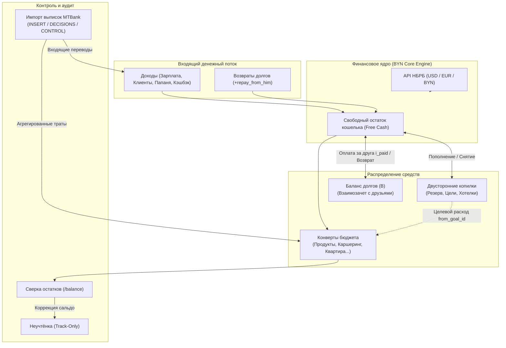

# 💰 Finance Tracker

<div align="center">


**Умный персональный финансовый движок с конвертным бюджетированием, взаимозачетом совместных трат, двусторонними копилками и автоматизированным парсингом банковских выписок.**

[Быстрый старт](#-быстрый-старт) • [Возможности](#-ключевые-возможности) • [Архитектура](#-архитектура-системы) • [Деплой](#-развертывание-в-облаке) • [Документация](docs/SPECIFICATION.md)

</div>

---

## 🌟 Ключевые особенности

- ✉️ **6-Конвертное бюджетирование (Weekly / Monthly)** — гибкое распределение лимитов по периодам (`Неделя` для динамических трат вроде продуктов и каршеринга, `Месяц` для аренды и коммуналки).
- 🤝 **Учет совместных расходов и долгов (Split Expenses & Debts)** — оплата чеков картой с автоматическим вычитанием чужой доли: личный конверт защищён от чужих трат, а баланс взаиморасчётов ($B$) сальдируется автоматически.
- 🎯 **Двусторонние накопительные копилки (Two-Way Savings)** — снятие денег из копилки как в свободный остаток, так и *напрямую на целевой расход* без искажения недельного лимита конверта.
- ⚖️ **Еженедельный аудит остатков (Balance Reconciliation)** — сверка фактического остатка на картах и наличных с расчетным балансом. Расхождения прозрачно фиксируются через системный конверт `Неучтёнка`.
- 🤖 **Интеллектуальный импорт банковских выписок (MTBank PDF/CSV)** — разбор транзакций, строгая классификация по MCC и торговым точкам, агрегация микроплатежей и математический контроль баланса шапки выписки.
- 💱 **Мультивалютность и живые курсы НБРБ** — учет операций в `BYN`, `USD`, `EUR` с автоматическим обновлением курсов по API Национального банка Республики Беларусь.
- 🚀 **Zero-Config Offline First или Облако** — из коробки работает на локальном SQLite без установки СУБД, при необходимости бесшовно переключается на PostgreSQL (Supabase / Render).

---

## 🏗 Архитектура системы



---

## 🧭 Обзор модулей

### 1. 📊 Главный дашборд (`/`)
Интерактивный командный центр личных финансов:
* **KPI-сводка**: суммарный доход за месяц, фактические расходы, свободный остаток и динамика накоплений.
* **Индикаторы лимитов**: цветовая шкала исчерпания бюджетов (Зеленый $\le 75\%$, Желтый $75\dots 99\%$, Красный $\ge 100\%$).
* **Аналитические диаграммы**: интерактивные графики Chart.js с распределением трат по категориям и динамикой приходов.
* **Календарь ожидаемых поступлений**: мониторинг регулярных доходов со статусом «Получено / Ожидается».

### 2. ✉️ Конверты бюджета (`/budget`)
* **Разделение периодов**: гибкое назначение цикла бюджета — недельный (продукты, такси, каршеринг) или месячный (жилье, связь, подписки).
* **Мгновенное добавление списаний**: поддержка компактных комментариев с множителями вендоров (например, `HELLO×6, ANY-TIME×1`).
* **Изолированный конверт «Неучтёнка»**: системная категория (`track_only = 1`), которая фиксирует расхождения при ревизиях, не ломая целевые планы.

### 3. 🤝 Долги и совместные чеки (`/debts`)
Полная реализация модели сальдированного долга:
* **Сплит расходов («Разделить чек»)**: при оплате общего счета в кафе или поездки картой, сумма автоматически бьется на личный расход и долг друга (`i_paid`). Ваш конверт не расходуется сверх вашей реальной доли.
* **4 типа записей**:
  * `i_paid` — я заплатил за человека ($B$ растет);
  * `he_paid` — человек заплатил за меня ($B$ падает);
  * `repay_from_him` — мне вернули долг ($B$ падает);
  * `repay_to_him` — я вернул долг ($B$ растет).
* **Автоматический нетто-баланс**: автоматический взаимозачет встречных долгов без необходимости ручных сверок.

### 4. 🎯 Двусторонние накопления (`/savings`)
* **Гибкие цели**: создание копилок с дедлайнами, целевыми суммами и мультивалютными планами.
* **Снятие на цель без перерасхода**: возможность совершить расход из конверта за счет накоплений (флаг `from_goal_id`). Сумма списывается с копилки, а недельный лимит конверта не уходит в красную зону.
* **Возврат в свободные деньги**: вывод накоплений обратно в операционный кошелек в один клик.

### 5. ⚖️ Сверка остатков (`/balance`)
* Регулярный аудит фактических денег на руках и на картах.
* Автоматический расчет отклонения: $\Delta = \text{Факт} - \text{Расчетный остаток}$.
* Внесение корректирующей транзакции в «Неучтёнку» для сохранения непрерывности финансовой истории.

### 6. 🤖 Парсер выписок МТБанк (`scripts/import_statement.py`)
Полнофункциональный конвейер обработки банковских PDF/CSV:
* **Автоклассификация**: распределение по MCC (5411 $\rightarrow$ Продукты, 7512 $\rightarrow$ Каршеринг и т.д.) и паттернам названий точек.
* **3-Блочный отчет**:
  1. `INSERT_CSV` — валидные расходы, сгруппированные по дням и категориям с агрегацией source_times.
  2. `DECISIONS_CSV` — переводы, налоги и P2P-поступления, требующие подтверждения пользователя.
  3. `CONTROL` — математическая верификация: $\text{Входящий} + \text{Поступило} - \text{Списано} = \text{Исходящий}$.
* **Защита от дубликатов**: проверка существующих записей в БД перед вставкой.

---

## 🚀 Быстрый старт

### Требования
- Python 3.10+
- Git

### 1. Клонирование репозитория
```bash
git clone https://github.com/endarver-lgtm/finance.git
cd finance
```

### 2. Запуск на Windows (в 1 клик)
Просто запустите файл запуска:
```bat
start.bat
```
Скрипт автоматически создаст виртуальное окружение `.venv`, установит зависимости, проведет миграцию локальной базы `finance.db` и откроет приложение в браузере по адресу `http://127.0.0.1:5000`.

*(Опционально: создайте удобный ярлык на рабочем столе командой `install_desktop.bat`)*

### 3. Запуск на Linux / macOS
```bash
chmod +x start.sh
./start.sh
```

---

## ⚙️ Переменные окружения (`.env`)

Скопируйте пример конфигурации:
```bash
cp .env.example .env
```

| Переменная | По умолчанию | Описание |
|------------|--------------|----------|
| `DATABASE_PATH` | `finance.db` | Путь к локальному файлу SQLite |
| `DATABASE_URL` | *(пусто)* | Postgres URI (при деплое в Supabase / Render) |
| `SECRET_KEY` | `dev-secret-key...` | Секретный ключ сессий Flask |
| `DEFAULT_CURRENCY` | `BYN` | Базовая валюта системы (`BYN`, `USD`, `EUR`) |
| `DEFAULT_DEBT_PERSON` | `Кент` | Имя контакта по умолчанию для сплита чеков |
| `USD_RATE` | `3.27` | Резервный курс USD при недоступности API |
| `EUR_RATE` | `3.55` | Резервный курс EUR при недоступности API |

---

## 🛠 Управление и CLI

Приложение включает удобный CLI-интерфейс через `manage.py`:

```bash
# Обновление курсов валют через официальный API НБРБ
python manage.py update-rates

# Просмотр текущих курсов в БД
python manage.py show-rates

# Полный сброс таблиц базы данных (очистка)
python manage.py reset

# Запуск встроенных автотестов
python scripts/verify_db.py
```

---

## 🧪 Надежность и верификация (Автотесты)

Система покрыта строгим набором автоматизированных тестов [`scripts/verify_db.py`](scripts/verify_db.py), проверяющих все 11 ключевых бизнес-сценариев:
- [x] **Smoke-тесты HTTP**: проверка статус-кодов всех ключевых маршрутов (`/`, `/budget`, `/savings`, `/debts`, `/income`, `/balance`, `/history`).
- [x] **Изоляция сплита**: сохранение правильного остатка бюджета при частичной оплате за третье лицо.
- [x] **Двусторонние копилки**: корректность снятия целевых денег и восстановления баланса.
- [x] **Сальдирование долгов**: математическая точность встречных погашений ($B$).
- [x] **Сверка остатков**: правильное вычисление дельты и создание корректирующей записи в «Неучтёнке».
- [x] **Импорт выписок**: агрегация операций и защита от повторного внесения дубликатов.

Запуск тестов:
```bash
python scripts/verify_db.py
```

---

## ☁️ Развертывание в облаке

Приложение готово к продакшн-деплою на связке **Render (Compute) + Supabase (Postgres Database)**:
- В репозитории уже настроены `Procfile`, `render.yaml` и схема Postgres [`supabase/schema.sql`](supabase/schema.sql).
- Полная пошаговая инструкция с настройкой переменных и пулеров соединений описана в файле [**DEPLOY.md**](DEPLOY.md).

---

## 📁 Структура проекта

```text
finance/
├── app.py                     # Точка входа Flask-приложения и фабрика
├── config.py                  # Конфигурация, чтение .env и дефолтные параметры
├── manage.py                  # CLI команды (обновление курсов, сброс БД)
├── DEPLOY.md                  # Пошаговый гайд по деплою на Render + Supabase
├── start.bat / start.sh       # Скрипты быстрого запуска для Windows и Unix
├── requirements.txt           # Зависимости Python
│
├── db/                        # Слой работы с базой данных
│   ├── connection.py          # Универсальный адаптер (SQLite / PostgreSQL)
│   ├── schema.py              # DDL-схема таблиц
│   ├── migrate.py             # Автоматические миграции структуры
│   └── settings.py            # Хранилище ключ-значение настроек
│
├── routes/                    # Контроллеры и маршруты Flask
│   ├── dashboard.py           # Главная страница и аналитика
│   ├── budget.py              # Конверты, списания и недельные лимиты
│   ├── income.py              # Источники доходов и поступления
│   ├── savings.py             # Копилки и финансовые цели
│   ├── debts.py               # Долги, сплит-расходы и взаимозачет
│   ├── balance.py             # Сверка и аудит остатков
│   ├── history.py             # Журнал транзакций с фильтрацией
│   └── settings.py            # Настройки курсов и валют
│
├── services/                  # Бизнес-логика и сервисы
│   ├── analytics.py           # Расчет KPI, аналитики и остатков
│   ├── debts.py               # Логика взаиморасчетов и сплитов
│   ├── savings.py             # Управление целями и целевыми списаниями
│   ├── reconcile.py           # Алгоритм сверки остатков кошелька
│   ├── nbrb.py                # Клиент к API Нацбанка РБ
│   ├── currency.py            # Конвертация валют
│   └── repository.py          # Доступ к данным и выборки
│
├── templates/                 # Шаблоны Jinja2 (адаптивный темный UI)
├── static/                    # Стили CSS, иконки и Chart.js скрипты
├── scripts/                   # Утилиты
│   ├── import_statement.py    # Импорт и классификация банковских выписок
│   └── verify_db.py           # Автоматический тестовый раннер
└── docs/                      # Проектная документация
    └── SPECIFICATION.md       # Полная архитектурная спецификация (70 KB)
```

---

## 📄 Лицензия

Распространяется под лицензией [MIT](LICENSE). Разработано для прозрачного, простого и полного контроля над личным капиталом.
