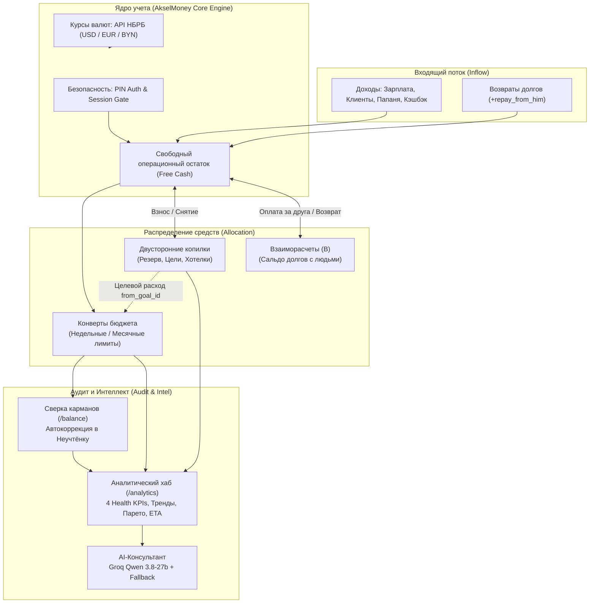

# 💰 AkselMoney — Персональный финансовый движок

<div align="center">


**Высокоточная система персонального финансового учета, конвертного бюджетирования, сальдирования совместных долгов, аудита карманов и интеллектуального финансового анализа.**

[Быстрый старт](#-быстрый-старт) • [Возможности](#-ключевые-возможности) • [Аналитический центр](#-интеллектуальная-аналитика-и-ai-ассистент-analytics) • [Архитектура](#-архитектура-системы) • [Деплой на сервер](#-развертывание-на-сервере-ruvds--linux) • [Полная спецификация](docs/SPECIFICATION.md)

</div>

---

## 🌟 Ключевые возможности

### ✉️ 1. Конвертное бюджетирование (Zero-Based Envelope Budgeting)
* **Разделение периодов**: гибкое назначение лимитов по циклам — `Неделя` для волатильных бытовых трат (продукты, такси, каршеринг) и `Месяц` для фиксированных обязательств (аренда жилья, связь, сервисы).
* **Множители вендоров в комментариях**: поддержка быстрого ввода составных трат, например: `HELLO×6, ANY-TIME×1`.
* **Защищённый конверт «Неучтёнка»**: системная категория (`track_only = 1`), автоматически принимающая на себя расхождения при регулярных сверках, не искажая плановые лимиты рабочих конвертов.

### 🧠 2. Финансовая аналитика и AI-ассистент (`/analytics`)
* **Метрики здоровья капитала (Health Metrics)**:
  * **Норма сбережений (Savings Rate)** — процент активного дохода, направляемый в капитал и копилки.
  * **Подушка безопасности (Runway)** — автономный запас жизни в месяцах при среднем расходе за 90 дней.
  * **Дисциплина бюджета (Budget Adherence)** — процент конвертов расходов, удерживаемых строго в рамках лимита.
  * **Дневной расход (Burn Rate)** — фактическая скорость расходования средств в сутки.
* **Водопад денежного потока (Cash Flow Waterfall)**: наглядная цепочка распределения средств месяца: `Приходы` $\rightarrow$ `Конверты` $\rightarrow$ `Взносы в копилки` $\rightarrow$ `Снятия` $\rightarrow$ `Чистый свободный остаток`.
* **Макротренды за 6 месяцев**: интерактивный график соотношения доходов, расходов и сбережений с выводом средних показателей за полгода.
* **Структура трат и закон Парето**: высококонтрастная 12-цветная круговая диаграмма с автоматическим определением ядра расходов (20% категорий, формирующих 80% трат) и структурированным списком долей и сумм.
* **Сдвиги категорий (MoM Shifts)**: оперативный мониторинг аномалий — категории с наибольшим ростом трат и максимальной экономией относительно прошлого месяца.
* **Прогноз достижения целей (ETA Forecast)**: математическая экстраполяция текущего темпа пополнений с расчетом расчетной даты закрытия целей накоплений (`В графике` / `Отстаёт`).
* **ИИ-Консультант (Groq LLM Qwen 3.8-27b)**: генерация персонального аудита узких мест и рекомендаций на русском языке с надежным эвристическим фолбэком на случай отсутствия связи с API.

### 🤝 3. Взаиморасчеты и совместные чеки (`/debts`)
* **Сплит расходов («Разделить чек»)**: оплата общего счета в кафе, магазине или поездки картой владельца. Сумма делится на личную часть и долю друга: конверт расходуется строго на личную долю, а чужая часть переходит в баланс взаиморасчетов.
* **Модель сальдированного долга**: автоматический взаимозачет встречных долгов без циклических обязательств через 4 базовые операции:
  * `i_paid` — я заплатил за человека (баланс долга растет);
  * `he_paid` — человек заплатил за меня (баланс падает);
  * `repay_from_him` — мне вернули долг (баланс закрывается, деньги возвращаются в кошелек);
  * `repay_to_him` — я вернул долг (баланс закрывается, средства списываются).

### 🎯 4. Двусторонние накопительные копилки (`/savings`)
* **Категории целей**: резерв на непредвиденные нужды (`reserve`), целевые крупные покупки (`big`) и личные хотелки (`want`).
* **Целевое снятие на покупку (`withdraw_spent`)**: списание накоплений напрямую в категорию расходов с флагом `from_goal_id`. Сумма списывается с баланса копилки, отражается в аналитике трат, но **не приводит к перерасходу недельного лимита конверта**.
* **Возврат в кошелек (`withdraw_free`)**: вывод средств из копилки обратно в операционный свободный остаток.

### ⚖️ 5. Аудит фактических остатков карманов (`/balance`)
* **Контроль реальности**: еженедельная 3-минутная сверка фактических денег (карты + наличные в BYN, USD, EUR) с расчетным балансом системы.
* **Автоматическая нормализация**: при обнаружении расхождения система предлагает скорректировать остаток через списание недостачи в «Неучтёнку» или оприходование излишка.

### 🔒 6. Безопасность и PWA
* **Защита PIN-кодом**: 4-значный цифровой PIN с криптографическим хэшированием (PBKDF2/SHA-256), защитой от подбора (rate-limiting и блокировка сессии) и автопродлением сессии.
* **Полноценный PWA**: кастомная иконка приложения, манифест (`manifest.json`), поддержка Apple Touch Icon, запуск без рамок браузера («Add to Home Screen») с поддержкой safe-area insets.
* **Стабильный монолитный UI**: мгновенные переходы страниц без дерганий, артефактов наложения сайдбара и микролагов.

---

## 🏗 Архитектура системы



---

## 🧭 Обзор разделов приложения

| Раздел | Маршрут | Назначение и ключевые функции |
|---|---|---|
| **Дашборд** | `/` | Сводный командный центр: карточка здоровья капитала, переключатель периодов (`День / Неделя / Месяц / Год`), структура расходов, ожидаемые поступления, быстрый статус сверки. |
| **Аналитика** | `/analytics` | Глубокий аудит: 4 KPI здоровья, водопад Cash Flow, динамика 6 месяцев, 12-цветная круговая диаграмма Парето, динамика сдвигов трат, прогноз сроков закрытия копилок и AI-ассистент. |
| **Приходы** | `/income` | Учет источников дохода (регулярные и разовые), план-факт за месяц, фиксация поступлений в BYN/USD/EUR. |
| **Бюджет** | `/budget` | Управление недельными и месячными конвертами, шкалы прогресса, списание расходов, встроенный сплит чеков за компанию. |
| **Накопления** | `/savings` | Финансовые цели, пополнение копилок, снятие средств на покупку (с защитой лимитов) или возврат в операционный остаток. |
| **Долги** | `/debts` | Сальдированный учет взаиморасчетов с людьми, сплит совместных чеков, быстрый возврат долга в один клик. |
| **Сверка** | `/balance` | 5-минутный пересчет фактической наличности и карт в мультивалютном калькуляторе с автоматической проводкой расхождений. |
| **История** | `/history` | Полный хронологический журнал транзакций с фильтрацией по категориям, типам операций и диапазону дат. |
| **Настройки** | `/settings` | Синхронизация официальных курсов НБРБ, смена 4-значного PIN-кода, управление ключами Groq AI и параметрами сверки. |

---

## 🚀 Быстрый старт

### Требования
* Python 3.10 или новее
* Git
* SQLite3 (входит в стандартную поставку Python)

### Установка и локальный запуск

1. **Клонируйте репозиторий**:
   ```bash
   git clone https://github.com/endarver-lgtm/finance.git
   cd finance
   ```

2. **Создайте и активируйте виртуальное окружение**:
   ```bash
   # Windows
   python -m venv venv
   venv\Scripts\activate

   # Linux / macOS
   python3 -m venv venv
   source venv/bin/activate
   ```

3. **Установите зависимости**:
   ```bash
   pip install -r requirements.txt
   ```

4. **Настройте переменные окружения**:
   Скопируйте пример конфигурации:
   ```bash
   cp .env.example .env
   ```
   В файле `.env` укажите:
   ```ini
   SECRET_KEY=your-secure-random-secret-key
   APP_PASSWORD=your-strong-password-or-pin
   DATABASE_PATH=finance.db
   GROQ_API_KEY=your_groq_api_key_optional
   ```

5. **Запустите приложение**:
   * **Windows (в 1 клик)**: дважды кликните по `start.bat`
   * **Linux / macOS**: запустите `./start.sh`
   * **Вручную через терминал**:
     ```bash
     python app.py
     ```
   Приложение откроется в браузере по адресу: `http://127.0.0.1:5000` (введите заданный в `.env` пароль или PIN).

---

## 🧪 Запуск автоматических тестов

В проект встроен комплексный верификационный тест бизнес-правил и целостности данных:

```bash
python scripts/verify_db.py
```

Тест автоматически проверяет:
* Валидацию схемы SQLite и системных категорий (`Неучтёнка`);
* HTTP Smoke тесты всех разделов (код 200 под авторизованной сессией);
* Снятие из копилок на целевую покупку без поломки конверта (Тест A);
* Возврат из копилок в свободные деньги (Тест B);
* Защиту от овердрафта копилок (Тест C);
* Сплит совместных трат и сальдирование взаимных долгов (Тесты D, E, F, G);
* Каскадное удаление транзакций (Тест H);
* Математический расчет ожидаемого баланса при сверках (Тест I);
* Идемпотентность миграций схемы (Тест K).

---

## 🌐 Развертывание на сервере (RuVDS / Linux)

Приложение спроектировано для непрерывной работы на виртуальных серверах под управлением **Debian 12/13** или **Ubuntu 22.04/24.04**.

### 1. Подготовка окружения на сервере
```bash
sudo apt update && sudo apt install -y python3 python3-venv python3-pip git nginx
sudo mkdir -p /opt/finance
sudo chown -R root:root /opt/finance
cd /opt/finance
```

### 2. Конфигурация Systemd (`/etc/systemd/system/finance.service`)
```ini
[Unit]
Description=AkselMoney Financial Engine
After=network.target

[Service]
User=finance
Group=finance
WorkingDirectory=/opt/finance
Environment="PATH=/opt/finance/venv/bin"
EnvironmentFile=/opt/finance/.env
ExecStart=/opt/finance/venv/bin/gunicorn -w 3 -b 127.0.0.1:5000 app:app
Restart=always
RestartSec=5

[Install]
WantedBy=multi-user.target
```

### 3. Запуск и автозагрузка службы
```bash
# Создание выделенного системного пользователя finance
sudo useradd -r -s /usr/sbin/nologin finance
sudo chown -R finance:finance /opt/finance

sudo systemctl daemon-reload
sudo systemctl enable finance
sudo systemctl start finance
sudo systemctl status finance
```

### 4. Конфигурация Nginx Reverse Proxy (HTTPS / SSL)
```nginx
# Редирект HTTP на HTTPS
server {
    listen 80;
    server_name your-domain.com <your_server_ip>;
    return 301 https://$host$request_uri;
}

# Защищенный HTTPS сервер
server {
    listen 443 ssl http2;
    server_name your-domain.com <your_server_ip>;

    ssl_certificate /etc/ssl/certs/finance.crt;
    ssl_certificate_key /etc/ssl/private/finance.key;
    ssl_protocols TLSv1.2 TLSv1.3;
    ssl_ciphers HIGH:!aNULL:!MD5;

    client_max_body_size 16M;

    location / {
        proxy_pass http://127.0.0.1:5000;
        proxy_set_header Host $host;
        proxy_set_header X-Real-IP $remote_addr;
        proxy_set_header X-Forwarded-For $proxy_add_x_forwarded_for;
        proxy_set_header X-Forwarded-Proto $scheme;
    }

    location /static/ {
        alias /opt/finance/static/;
        expires 30d;
        add_header Cache-Control "public, max-age=2592000";
    }
}
```

### 5. Обновление кода без потери базы данных
База данных `finance.db` изолирована от Git. Для доставки обновлений:
```bash
# На локальной машине: упаковка измененных файлов без БД
tar -czf update.tar.gz app.py config.py routes/ services/ static/ templates/

# Доставка на сервер
scp update.tar.gz root@<your_server_ip>:/tmp/

# Распаковка и перезапуск на сервере
ssh root@<your_server_ip> "tar -xzf /tmp/update.tar.gz -C /opt/finance && chown -R finance:finance /opt/finance && rm /tmp/update.tar.gz && systemctl restart finance"
```

---

## 📄 Лицензия

Проект распространяется под лицензией **MIT**. Подробная техническая спецификация, математические формулы и модель данных приведены в [docs/SPECIFICATION.md](docs/SPECIFICATION.md).
