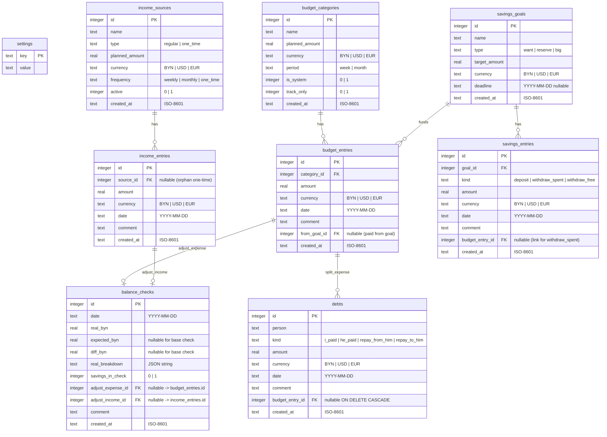
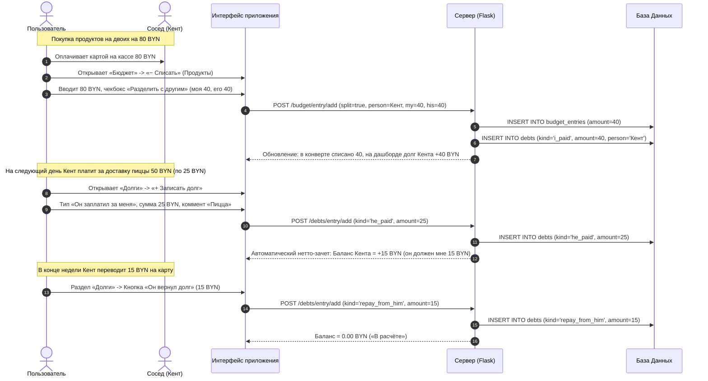

# Спецификация проекта Finance Tracker

## 1. Введение и назначение системы

### 1.1. Общие сведения
**Finance Tracker** — это веб-приложение для персонального и семейного финансового учета и планирования. Система ориентирована на учет денежных потоков в белорусских рублях (**BYN**) с мультивалютным вводом и автоматической оценкой в долларах США (**USD**) и евро (**EUR**) по официальным курсам Национального банка Республики Беларусь (**НБРБ**).

Приложение спроектировано на стыке четырех ключевых финансовых практик:
1. **Метод конвертов (Envelope Budgeting)** — жесткое лимитирование операционных расходов по категориям на неделю или месяц.
2. **Планирование Cash Flow и целей** — разделение доходов на регулярные и разовые, контроль ожидаемых поступлений, свободного денежного остатка (Free Cash Flow) и фонда накоплений (резерв, хотелки, крупные цели).
3. **Учет взаиморасчетов и долгов (Debts & Split Expenses)** — фиксация совместных трат (например, с соседом по жилью), автоматический нетто-взаимозачет и изоляция чужих трат от собственных лимитов бюджета.
4. **Сверка с реальным остатком (Balance Reconciliation)** — еженедельный аудит фактических остатков на картах и наличных денег с фиксацией расхождений через системную категорию «Неучтёнка».

### 1.2. Ключевые цели продукта
- **Прозрачность финансовой картины**: моментальный ответ на вопросы «Сколько заработано?», «Сколько потрачено?», «Сколько осталось до конца недели/месяца?», «Каков свободный остаток?», «Кто кому сколько должен?».
- **Предотвращение перерасхода**: визуальный контроль исчерпания недельных и месячных лимитов с предупреждающей цветовой индикацией.
- **Двусторонние копилки**: возможность не только пополнять накопительные цели, но и снимать средства как на целевые расходы (без слома недельных лимитов конвертов), так и обратно в свободные деньги.
- **Мультивалютность без рутины**: фиксация операций в удобной пользователю валюте (BYN, USD, EUR) с фоновой нормализацией и прозрачным отображением курсовых эквивалентов.
- **Контроль реальности**: 5-минутная регулярная сверка показывает точность учета, предотвращая расхождение виртуального баланса с кошельком.
- **Автономность и мобильность**: возможность запуска как локально (настольный режим с базой SQLite и скриптами быстрого старта), так и в облаке (Flask/Gunicorn + PostgreSQL Supabase на Render). Доступ ко всем операциям со смартфона за 10–15 секунд (в пределах 2–3 тапов).

---

## 2. Архитектурная спецификация

### 2.1. Технологический стек

| Уровень | Технология | Описание и назначение |
|---|---|---|
| **Backend Framework** | Python 3.10+, Flask 3.0 | Легковесный WSGI веб-сервер, модульная архитектура на Blueprints |
| **База данных** | SQLite 3 (`finance.db`) / PostgreSQL | Локальный движок SQLite с поддержкой внешних ключей (`PRAGMA foreign_keys = ON`); полная совместимость с PostgreSQL (Supabase) |
| **Интерфейс / Шаблонизация** | Jinja2, HTML5, CSS3 Custom Properties | Серверный рендеринг, кастомная дизайн-система, полная адаптивность под Desktop (Sidebar) и Mobile (Bottom-Nav + "Ещё") |
| **Интерактивные графики** | Chart.js 4.4.3 | Клиентская визуализация структуры расходов и динамики план-факт |
| **Внешние интеграции** | REST API НБРБ (`api.nbrb.by`) | Автоматическая ежедневная синхронизация официальных курсов валют |
| **Запуск и развертывание** | `start.bat`, `start.sh`, Gunicorn, `Procfile` | Локальный запуск в один клик с автооткрытием браузера, облачный деплой на Render |

### 2.2. Архитектура приложения

```mermaid
graph TD
    User["Пользователь (Desktop / Mobile Browser)"]
    
    subgraph UI ["Клиентский уровень (Frontend)"]
        HTML["Jinja2 Templates (base, dashboard, budget, income, savings, debts, balance, history, settings)"]
        CSS["style.css (CSS Variables, Flexbox/Grid, Responsive Sidebar/Bottom-Nav)"]
        JS["app.js / dashboard.js (Модальные окна, динамические расчёты, Chart.js)"]
    end
    
    subgraph Backend ["Серверный уровень (Flask Application)"]
        AppInit["app.py (create_app, context_processor, template_filters, Blueprints registration)"]
        Routes["Модули маршрутов (routes/):<br/>dashboard, income, budget, savings, debts, balance, history, settings"]
        Services["Сервисный слой (services/):<br/>analytics, debts, reconcile, savings, planning, currency, nbrb, dates, repository, forms, progress"]
        DBLayer["Слой доступа к данным (db/):<br/>connection, schema, settings, migrate"]
    end
    
    subgraph DataStorage ["Уровень хранения данных"]
        SQLite[("SQLite: finance.db")]
        Supabase[("PostgreSQL: Supabase (Cloud)")]
    end
    
    subgraph External ["Внешние сервисы"]
        NBRB["API НБРБ (https://api.nbrb.by)"]
    end

    User -->|HTTP Requests / Forms| HTML
    HTML --> JS
    JS -->|Render Charts / DOM| HTML
    HTML --> Routes
    Routes --> Services
    Services --> DBLayer
    Services -->|HTTP GET (Курсы)| NBRB
    DBLayer --> SQLite
    DBLayer -.->|Опционально| Supabase
```

### 2.3. Структура директорий проекта
```
finance/
├── app.py                      # Точка входа Flask-приложения, регистрация блюпринтов и фильтров
├── config.py                   # Конфигурация (переменные окружения, пути, секретные ключи)
├── manage.py                   # CLI-утилита для управления (update-rates, reset)
├── finance.db                  # Основная локальная база данных SQLite
├── db/                         # Слой взаимодействия с базой данных
│   ├── __init__.py             # Экспорт интерфейсов БД
│   ├── connection.py           # Пул и обертка подключений (Row-фабрика, адаптация %s -> ?)
│   ├── schema.py               # DDL схемы таблиц, порядок удаления и инициализация
│   ├── settings.py             # CRUD настроек key-value
│   └── migrate.py              # Идемпотентные миграции для SQLite и PostgreSQL
├── routes/                     # Контроллеры / Маршруты страниц
│   ├── dashboard.py            # Сводный дашборд и KPI
│   ├── income.py               # Источники дохода и поступления
│   ├── budget.py               # Конверты и списания расходов (в т.ч. совместные траты)
│   ├── savings.py              # Цели накоплений, пополнения и снятия
│   ├── debts.py                # Баланс долгов, взаиморасчеты и возвраты
│   ├── balance.py              # Еженедельная сверка реального остатка
│   ├── history.py              # Журнал транзакций и фильтры
│   └── settings.py             # Настройки валют, сверки и синхронизация НБРБ
├── services/                   # Бизнес-логика и сервисы
│   ├── analytics.py            # Агрегаты KPI, расчет Free Cash Flow, выборки для графиков
│   ├── debts.py                # Бизнес-правила взаиморасчетов, сплитов и долгов
│   ├── reconcile.py            # Логика сверки остатков и автокоррекции
│   ├── savings.py              # Логика пополнений и снятий из копилок
│   ├── planning.py             # Масштабирование планов под периоды (день/неделя/месяц/год)
│   ├── repository.py           # Операции чтения/записи доменных сущностей
│   ├── currency.py             # Конвертация валют (BYN/USD/EUR), расчет курсов
│   ├── nbrb.py                 # Интеграция с REST API Нацбанка РБ
│   ├── dates.py                # Календарная математика, периоды, форматирование дат
│   ├── forms.py                # Валидация и парсинг форм ввода
│   ├── progress.py             # Расчет процентов, статусов и цветов прогресс-баров
│   └── constants.py            # Константы валют, периодов и меток
├── templates/                  # Шаблоны Jinja2
│   ├── base.html               # Базовый лейаут (Sidebar, Mobile Bottom Nav + "Ещё", курсы)
│   ├── macros.html             # UI-макросы (money, currency_select, period_switcher)
│   ├── dashboard.html          # Главная страница
│   ├── income.html             # Страница приходов
│   ├── budget.html             # Страница бюджета (конверты)
│   ├── savings.html            # Страница накоплений
│   ├── debts.html              # Страница долгов и взаимозачетов
│   ├── balance.html            # Страница сверки остатка
│   ├── history.html            # Страница истории операций
│   └── settings.html           # Страница настроек
├── static/                     # Статические ресурсы
│   ├── css/style.css           # Основные стили, CSS переменные, сетки
│   └── js/
│       ├── app.js              # Инициализация модальных окон, хелперы графиков и форм
│       └── dashboard.js        # Инициализация Chart.js графиков на дашборде
├── scripts/                    # Вспомогательные скрипты
│   ├── verify_db.py            # Комплексные тесты бизнес-правил (A–K) и HTTP Smoke
│   └── create_desktop_shortcut.ps1 # Генератор ярлыка рабочего стола Windows
├── start.bat                   # Быстрый старт на Windows
└── start.sh                    # Быстрый старт на macOS/Linux
```

---

## 3. Модель данных (Data Model)

### 3.1. Entity-Relationship (ER) диаграмма



### 3.2. Детальное описание таблиц

#### `settings`
Хранилище конфигурационных параметров приложения в формате «ключ — значение»:
- `key` (TEXT, PK): Имя параметра (`currency`, `usd_rate`, `eur_rate`, `rates_updated_at`, `rates_nbrb_date`, `savings_in_check`, `default_debt_person`).
- `value` (TEXT): Значение параметра:
  - `savings_in_check`: `'1'` (по умолчанию) — копилки входят в сверяемый реальный остаток; `'0'` — копилки лежат отдельно и не учитываются при сверке.
  - `default_debt_person`: Имя контрагента по умолчанию (по умолчанию `'Кент'`).

#### `income_sources`
Источники доходов (зарплата, подработка, клиенты, контракты):
- `id` (INTEGER, PK, Autoincrement).
- `name` (TEXT): Название источника.
- `type` (TEXT): `regular` (постоянный) или `one_time` (разовый проект).
- `planned_amount` (REAL): Планируемая сумма поступления в валюте источника.
- `currency` (TEXT): Валюта плана (`BYN`, `USD`, `EUR`). По умолчанию `BYN`.
- `frequency` (TEXT): Периодичность (`weekly` — еженедельно, `monthly` — ежемесячно, `one_time` — разово).
- `active` (INTEGER): Флаг активности (1 — активен, 0 — в архиве).
- `created_at` (TEXT): Временная метка ISO-8601.

#### `income_entries`
Фактические поступления денежных средств:
- `id` (INTEGER, PK, Autoincrement).
- `source_id` (INTEGER, FK -> `income_sources.id` ON DELETE SET NULL, Nullable): Связь с источником. Если `NULL` — поступление считается независимым разовым доходом (или неучтённым приходом по результатам сверки).
- `amount` (REAL): Фактически поступившая сумма.
- `currency` (TEXT): Валюта поступления (`BYN`, `USD`, `EUR`).
- `date` (TEXT): Дата получения средств в формате `YYYY-MM-DD`.
- `comment` (TEXT, Nullable): Пользовательский комментарий.
- `created_at` (TEXT): Временная метка ISO-8601.

#### `budget_categories`
Категории расходов («конверты»):
- `id` (INTEGER, PK, Autoincrement).
- `name` (TEXT): Название категории (например, «Продукты», «Транспорт», «Неучтёнка»).
- `planned_amount` (REAL): Лимит расходов на установленный период. Для системных категорий может быть `0.0`.
- `currency` (TEXT): Валюта лимита.
- `period` (TEXT): Период действия лимита (`week` — неделя, `month` — месяц).
- `is_system` (INTEGER, Default 0): Флаг системной категории (1 — нельзя удалить или переименовать).
- `track_only` (INTEGER, Default 0): Режим фиксации без лимита (1 — не имеет лимита, исключается из расчета исчерпания процентов).
- `created_at` (TEXT): Временная метка ISO-8601.

*Примечание*: Системная категория `Неучтёнка` создается автоматически при инициализации/миграции базы данных со свойствами: `name='Неучтёнка'`, `planned_amount=0`, `currency='BYN'`, `period='month'`, `is_system=1`, `track_only=1`.

#### `budget_entries`
Фактические списания расходов по конвертам:
- `id` (INTEGER, PK, Autoincrement).
- `category_id` (INTEGER, FK -> `budget_categories.id` ON DELETE CASCADE): Категория расхода.
- `amount` (REAL): Сумма списания.
- `currency` (TEXT): Валюта списания.
- `date` (TEXT): Дата покупки/списания (`YYYY-MM-DD`).
- `comment` (TEXT, Nullable): Комментарий (наименование магазина, детализация).
- `from_goal_id` (INTEGER, FK -> `savings_goals.id` ON DELETE SET NULL, Nullable): Идентификатор копилки, если покупка оплачена за счет снятия из накоплений.
- `created_at` (TEXT): Временная метка ISO-8601.

#### `savings_goals`
Цели накоплений («копилки»):
- `id` (INTEGER, PK, Autoincrement).
- `name` (TEXT): Название цели (например, «Подушка безопасности», «Новый ноутбук», «Отпуск»).
- `type` (TEXT): Категория цели (`want` — хотелка, `reserve` — финансовый резерв, `big` — крупная покупка).
- `target_amount` (REAL): Целевая сумма накопления.
- `currency` (TEXT): Валюта цели.
- `deadline` (TEXT, Nullable): Желаемая дата достижения цели (`YYYY-MM-DD`).
- `created_at` (TEXT): Временная метка ISO-8601.

#### `savings_entries`
Транзакции пополнения и снятия по копилкам:
- `id` (INTEGER, PK, Autoincrement).
- `goal_id` (INTEGER, FK -> `savings_goals.id` ON DELETE CASCADE): Идентификатор цели.
- `kind` (TEXT, Default `'deposit'`): Тип транзакции:
  - `deposit` — внесение средств в копилку;
  - `withdraw_spent` — снятие средств на конкретную трату (с созданием записи в бюджете);
  - `withdraw_free` — снятие средств и возврат в свободные наличные деньги.
- `amount` (REAL): Сумма транзакции (всегда положительное число; знак определяется типом `kind`).
- `currency` (TEXT): Валюта операции.
- `date` (TEXT): Дата операции (`YYYY-MM-DD`).
- `comment` (TEXT, Nullable): Комментарий.
- `budget_entry_id` (INTEGER, FK -> `budget_entries.id` ON DELETE SET NULL, Nullable): Ссылка на расход в бюджете для транзакций типа `withdraw_spent`.
- `created_at` (TEXT): Временная метка ISO-8601.

#### `debts`
Журнал учета долгов и взаимозачетов с людьми:
- `id` (INTEGER, PK, Autoincrement).
- `person` (TEXT): Имя контрагента (например, «Кент»).
- `kind` (TEXT): Тип долговой операции:
  - `i_paid` — я оплатил за него;
  - `he_paid` — он оплатил за меня;
  - `repay_from_him` — он вернул мне долг деньгами;
  - `repay_to_him` — я вернул ему долг деньгами.
- `amount` (REAL): Сумма операции (> 0).
- `currency` (TEXT): Валюта операции (`BYN`, `USD`, `EUR`).
- `date` (TEXT): Дата операции (`YYYY-MM-DD`).
- `comment` (TEXT, Nullable): Комментарий к долгу.
- `budget_entry_id` (INTEGER, FK -> `budget_entries.id` ON DELETE CASCADE, Nullable): Связанный расход в бюджете (для совместных чеков).
- `created_at` (TEXT): Временная метка ISO-8601.

*Индексы*: `idx_debts_person_date` по `(person, date)`, `idx_debts_budget_entry` по `(budget_entry_id)`.

#### `balance_checks`
Акты еженедельной сверки виртуального и фактического остатка:
- `id` (INTEGER, PK, Autoincrement).
- `date` (TEXT): Дата сверки (`YYYY-MM-DD`).
- `real_byn` (REAL): Фактическая сумма остатка во всех карманах, выраженная в BYN.
- `expected_byn` (REAL, Nullable): Расчетный ожидаемый остаток (для первой базовой сверки равен `NULL`).
- `diff_byn` (REAL, Nullable): Расхождение $\text{diff} = \text{real\_byn} - \text{expected\_byn}$ (для базовой сверки `NULL`).
- `real_breakdown` (TEXT, Nullable): JSON-снапшот ввода: `{"byn": 1000.0, "usd": 50.0, "eur": 0.0}`.
- `savings_in_check` (INTEGER): Значение настройки `savings_in_check` на момент выполнения сверки.
- `adjust_expense_id` (INTEGER, FK -> `budget_entries.id` ON DELETE SET NULL, Nullable): Ссылка на созданный расход в категории «Неучтёнка» (при недостаче $\text{diff} < 0$).
- `adjust_income_id` (INTEGER, FK -> `income_entries.id` ON DELETE SET NULL, Nullable): Ссылка на созданный доход «Неучтённый приход» (при излишке $\text{diff} > 0$).
- `comment` (TEXT, Nullable): Комментарий к акту сверки.
- `created_at` (TEXT): Временная метка ISO-8601.

---

## 4. Бизнес-правила и логика расчетов

### 4.1. Мультивалютная система и конвертация
1. **Базовая валюта учета**: Все сводные показатели (KPI дашборда, суммарный факт приходов, суммарные расходы, баланс, сверка, графики) рассчитываются в **BYN**.
2. **Формулы пересчета**:
   $$\text{BYN} = \begin{cases} 
   \text{amount}, & \text{если currency} = \text{BYN} \\ 
   \text{amount} \times \text{usd\_rate}, & \text{если currency} = \text{USD} \\ 
   \text{amount} \times \text{eur\_rate}, & \text{если currency} = \text{EUR} 
   \end{cases}$$
   $$\text{USD} = \frac{\text{BYN}}{\text{usd\_rate}}$$
3. **Отображение денежных величин (UI Macro `money`)**:
   - Главная сумма отображается жирным шрифтом в BYN: `1 250.00 BYN`.
   - Рядом выводится компактный бейдж с долларовым эквивалентом: `≈ $382.26`.
   - Если исходная операция была создана в валюте (USD или EUR), дополнительно отображается бейдж с номиналом в валюте: `400.00 USD`.
4. **Сравнения с плавающей точкой**: Все сравнения денежных сумм производятся с точностью $\varepsilon = 0.005$, а результаты округляются до 2 знаков после запятой.

### 4.2. Масштабирование планов под выбранный период (Scaling Engine)
Для корректного сравнения планов и фактов в фильтрах Дашборда и раздела Приходов применяется алгоритм масштабирования частот (`services/planning.py`):

| Частота источника / конверта | Просмотр за День | Просмотр за Неделю | Просмотр за Месяц | Просмотр за Год |
|---|---|---|---|---|
| **Weekly** (Еженедельно) | $\times \frac{1}{7}$ | $\times 1$ | $\times 4$ | $\times 52$ |
| **Monthly** (Ежемесячно) | $\times \frac{1}{30}$ | $\times \frac{1}{4}$ | $\times 1$ | $\times 12$ |
| **One-Time** (Разовый доход) | $0$ или Plan* | $0$ или Plan* | $0$ или Plan* | $0$ или Plan* |

*\*Правило для разовых доходов (`one_time`)*:
- Если суммарный факт по источнику $\ge \text{Plan} - 0.005$, то план считается полностью выполненным и возвращает `0.00`, чтобы не раздувать ожидаемый план будущих периодов.
- Если разовый доход еще не получен и текущая дата попадает в границы просматриваемого интервала, плановая сумма учитывается в полном объеме.

### 4.3. Категории бюджета («Конверты») и изоляция трат из копилок
- Конверт имеет базовый интервал лимита: `week` или `month`.
- При переключении режима отображения на странице Бюджета:
  - Месячная категория на недельном экране отображает лимит: $\frac{\text{Лимит}}{4}$.
  - Недельная категория на месячном экране отображает лимит: $\text{Лимит} \times 4$.
- **Изоляция трат из копилок**:
  - Расходы, совершенные из копилок (`from_goal_id IS NOT NULL`), **не учитываются** в проценте исчерпания лимита конверта (`pct`) и в величинах «Потрачено»/«Осталось» на карточке категории. Траты из накоплений не должны ломать регулярный недельный лимит конверта.
  - Траты из копилок в полном объеме отображаются в детальной Истории, в аналитической структуре расходов по категориям (с пометкой копилки) и в отдельном KPI дашборда «Из копилок».
- **Системные категории (`track_only = 1`)**:
  - Категория «Неучтёнка» отображается без прогресс-бара и лимита (деление на ноль исключено). Ее невозможно удалить или переименовать (`is_system = 1`).
- **Цветовая градация прогресс-бара**:
  $$\text{pct} = \min\left(100, \frac{\text{Потрачено}_{\text{собственное, BYN}}}{\text{Плановый лимит}_{\text{BYN}}} \times 100\right)$$
  - $\text{pct} < 80\%$: Зеленый индикатор (`ok`) — комфортный остаток.
  - $80\% \le \text{pct} < 100\%$: Желто-оранжевый индикатор (`warning` / `pending`) — внимание, лимит на исходе.
  - $\text{pct} \ge 100\%$: Красный индикатор (`danger`) — лимит исчерпан или превышен.
  - Неизрасходованный остаток: $\max(0, \text{Плановый лимит} - \text{Потрачено}_{\text{собственное}})$.

### 4.4. Снятие средств из копилок (Savings Goal Withdrawals)
Текущий баланс копилки рассчитывается в валюте цели:
$$\text{Баланс цели} = \sum \text{deposit} - \sum \text{withdraw\_spent} - \sum \text{withdraw\_free}$$
где каждая сумма предварительно конвертируется в валюту цели: $\text{from\_byn}(\text{to\_byn}(\text{amount}, \text{entry\_currency}), \text{goal\_currency})$.

**Варианты снятия**:
1. **Цель «Потратил» (`withdraw_spent`)**:
   - Требует обязательного выбора категории бюджета.
   - В единой атомарной транзакции создается:
     - Запись в `savings_entries` (`kind = 'withdraw_spent'`);
     - Запись в `budget_entries` (`from_goal_id = goal_id`) на ту же сумму, валюту и дату.
     - Записи взаимно связываются через `savings_entries.budget_entry_id`.
   - Баланс цели уменьшается; лимит конверта не уменьшается; $Free$ Cash Flow не изменяется (так как деньги уже были списаны из $Free$ при внесении депозита).
2. **Цель «Вернуть в свободные» (`withdraw_free`)**:
   - Создается только запись в `savings_entries` (`kind = 'withdraw_free'`).
   - Расход в бюджете не создается.
   - Баланс цели уменьшается; свободный остаток $Free$ увеличивается на сумму возврата.
3. **Валидация**: Запрещено снимать сумму, превышающую текущий баланс копилки (с учетом курсовой конвертации). При попытке овердрафта операция отклоняется с сообщением пользователю.
4. **Удаление операции снятия**: При удалении записи `withdraw_spent` автоматически удаляется связанный расход в `budget_entries`. Баланс копилки восстанавливается.

### 4.5. Учет долгов и взаимозачетов (Debts & Split Expenses)

#### Вклад операций в баланс долга $B$
Баланс взаимных расчетов с конкретным человеком ($B$) определяется по правилу: **$B > 0$ означает, что человек должен мне; $B < 0$ означает, что я должен человеку**.

| Тип (`kind`) | Смысл операции | Вклад в $B$ | Влияние на кошелек пользователя |
|---|---|---|---|
| `i_paid` | Я заплатил за него | $+amount$ | Реальные деньги ушли из кошелька |
| `he_paid` | Он заплатил за меня | $-amount$ | Мой долг перед ним вырос |
| `repay_from_him` | Он вернул мне долг наличными/на карту | $-amount$ | Реальные деньги пришли в кошелек |
| `repay_to_him` | Я вернул ему долг | $+amount$ | Реальные деньги ушли из кошелька |

Встречные долги автоматически сальдируются (нетто-суммируются), отдельная операция взаимозачета не требуется.

#### Разделение совместных трат (Split Expense)
В модальном окне списания расхода доступен чекбокс **«Разделить с другим»**:
- **Сценарий 1: Я оплатил весь чек** (например, чек 60 BYN: моя доля 30, его доля 30):
  - В `budget_entries` записывается расход только на мою долю: `30 BYN`. Лимит конверта расходуется только на мои траты.
  - В `debts` записывается долг `i_paid` на его долю: `30 BYN` ($B$ увеличивается на `+30`).
  - Фактический отток денег из кошелька: $30 + 30 = 60 \text{ BYN}$.
- **Сценарий 2: Он оплатил весь чек** (чек 60 BYN: моя доля 30, его доля 30):
  - В `budget_entries` записывается расход на мою долю: `30 BYN`.
  - В `debts` записывается долг `he_paid` на мою долю: `30 BYN` ($B$ уменьшается на `-30`).
  - Фактический отток денег из кошелька в момент покупки: $0 \text{ BYN}$ (трата произойдет позже при возврате долга).
- **Сценарий 3: Я оплатил 100% за него** (моя доля 0):
  - Расход в бюджет не создается, создается только запись в `debts` (`i_paid`).

#### Каскадное удаление
При удалении расхода с разделением чек в бюджете каскадно удаляет связанную строку в `debts` благодаря внешнему ключу `ON DELETE CASCADE`.

### 4.6. Формула Свободного остатка (Free Cash Flow)
Свободный денежный остаток за выбранный отчетный период рассчитывается по уточненной формуле денежных потоков:

$$\text{Free} = \text{Приход} - \text{Расходы}_{\text{собственные}} - \text{Взносы} + \text{Возврат\_в\_свободные} - \Delta B$$

где:
- **$\text{Приход}$**: Сумма всех поступивших доходов за период (`income_entries`).
- **$\text{Расходы}_{\text{собственные}}$**: Сумма фактических списаний за период, оплаченных из собственных средств (`budget_entries` где `from_goal_id IS NULL`). Расходы из копилок сюда не входят, так как средства уже были учтены при внесении в копилку.
- **$\text{Взносы}$**: Пополнения копилок за период (`savings_entries` где `kind = 'deposit'`).
- **$\text{Возврат\_в\_свободные}$**: Снятия из копилок обратно в свободные средства (`savings_entries` где `kind = 'withdraw_free'`).
- **$\Delta B$**: Чистое изменение баланса долгов за период:
  $$\Delta B = \sum(\text{i\_paid}) - \sum(\text{he\_paid}) - \sum(\text{repay\_from\_him}) + \sum(\text{repay\_to\_him})$$
  *(В формулу $\text{Free}$ величина $\Delta B$ входит со знаком минус: когда я плачу за другого, $\Delta B > 0$ и свободный остаток уменьшается; когда мне возвращают долг, $\Delta B < 0$ и свободный остаток увеличивается).*

### 4.7. Сверка с реальным остатком (Balance Reconciliation)
Сверка позволяет сопоставить расчетный остаток в приложении с реальной суммой денег на картах и в кошельке.

#### 1. Базовая (первичная) сверка
- Выполняется при первом использовании функции.
- Пользователь пересчитывает все свои деньги (BYN, USD, EUR) и вводит сумму.
- Для базовой сверки `expected_byn = NULL`, `diff_byn = NULL`.
- Точка базовой сверки фиксируется как отправной остаток для будущих проверок.

#### 2. Регулярная сверка (расчет ожидания)
Для любой последующей сверки ожидаемый остаток рассчитывается от даты предыдущей сверки $T_{\text{prev}}$ до даты текущей сверки $T_{\text{curr}}$ по операциям в интервале $T_{\text{prev}} < \text{date} \le T_{\text{curr}}$:

$$\text{expected} = \text{last\_check.real} + \text{Приход} - \text{Расходы}_{\text{собственные}} - \Delta B - \text{Flows}_{\text{savings}}$$

где $\text{Flows}_{\text{savings}}$ зависят от настройки `savings_in_check`:
- Если `savings_in_check = 1` (копилки лежат в общей сумме):
  $$\text{Flows}_{\text{savings}} = \text{Расходы}_{\text{из\_копилок}}$$
  *(Взносы и возвраты являются перемещениями внутри посчитанных денег и не меняют общую сумму; уменьшает сумму только трата из копилки наружу).*
- Если `savings_in_check = 0` (копилки лежат на изолированном счете и пользователь их не считает):
  $$\text{Flows}_{\text{savings}} = \text{Взносы} - \text{Возврат\_в\_свободные}$$

#### 3. Расхождение и автоматическая корректировка
$$\text{diff} = \text{real\_byn} - \text{expected\_byn}$$
- **Если $\text{diff} = 0$ (допуск $0.005$)**: Учет абсолютно точен.
- **Если $\text{diff} < 0$ (недостача)**: Денег по факту меньше, чем в приложении. Создается расход в системной категории «Неучтёнка» на сумму $|\text{diff}|$ с привязкой `adjust_expense_id`. Дата расхода равна дате сверки.
- **Если $\text{diff} > 0$ (излишек)**: Денег по факту больше. Создается разовый доход «Неучтённый приход» на сумму $\text{diff}$ с привязкой `adjust_income_id`. Дата дохода равна дате сверки.
- Пользователь может выбрать режим «Не корректировать», если расхождение временное.

---

## 5. Функциональная спецификация модулей

### 5.1. Модуль «Дашборд» (`/`)
- **Назначение**: Главный экран оперативного мониторинга финансового статуса.
- **Элементы управления**: Переключатель периода (`День`, `Неделя`, `Месяц`, `Год`).
- **Сетка KPI карточек**:
  1. **Приход**: факт и план поступлений за период.
  2. **Расходы**: сумма собственных расходов с детальной строкой «в т.ч. из копилок: X BYN».
  3. **Свободный остаток**: расчетный $Free$ за период по новой формуле Cash Flow с цветовой подсветкой (зеленый / красный).
  4. **Долги** (кликабельная карточка со ссылкой на `/debts/`): отображает нетто-баланс (зеленый «Вам должны X BYN», красный «Вы должны X BYN» или нейтральный «В расчёте»).
  5. **Сверка** (кликабельная карточка со ссылкой на `/balance/`): дата последней проверки и статус («Сошлось», «Недостача», «Излишек»).
- **Аналитические виджеты**:
  - График структуры расходов по категориям (Chart.js) с бейджами копилок.
  - График план/факт за 6 месяцев.
  - Топ конвертов текущей недели.
  - Ожидаемые поступления.

### 5.2. Модуль «Приходы» (`/income`)
- Навигация по месяцам (`←`, `Сегодня`, `→`) и фильтрация по периодам.
- Плашка сводки периода: план, факт, % выполнения.
- Карточки источников дохода с автоматическим вычислением статуса:
  - `received` (Получено $\ge 100\%$);
  - `partial` (Частично получен);
  - `pending` (Ожидается).
- Модальные окна: «+ Новый источник», «+ Отметить поступление», «+ Разовый доход».

### 5.3. Модуль «Бюджет» (`/budget`)
- Переключение недельного и месячного режимов с автоматическим пересчетом масштаба лимитов.
- Карточки конвертов:
  - Прогресс-бар с цветовой индикацией (зеленый, желтый, красный).
  - Учет только собственных трат конверта (исключая траты из копилок).
  - Системная карточка «Неучтёнка» отображается с маркером `track_only` без прогресс-бара и лимита.
- Модальное окно **«Списание расхода»**:
  - Поля: сумма, валюта, дата, комментарий.
  - Чекбокс **«Разделить с другим»**:
    - Переключатель «Кто оплатил»: *Я оплатил весь чек* / *Он оплатил весь чек*.
    - Имя человека (с автоподстановкой дефолтного значения из настроек).
    - Моя доля и Его доля с авторасчетом второго поля при вводе первого.

### 5.4. Модуль «Накопления» (`/savings`)
- Группировка копилок по категориям: Хотелки, Резерв, Крупные цели.
- Карточка цели:
  - Текущий накопленный баланс в валюте цели с учетом всех взносов и снятий.
  - Прогресс-бар достижения цели.
  - Кнопка **«+ Пополнить»** (внесение `deposit`).
  - Кнопка **«− Снять»** (вызов модального окна снятия).
- Модальное окно **«Снятие из копилки»**:
  - Выбор цели вывода:
    - *«Потратил»*: выпадающий список категорий бюджета, автосоздание расхода с `from_goal_id`.
    - *«Вернуть в свободные»*: возврат денег в свободный остаток.
  - Сумма, валюта, дата, комментарий.
  - Валидация остатка: запрет снятия суммы, превышающей накопленное по цели.
- Список истории пополнений и снятий внутри карточки (`<details>`) с возможностью удаления ошибочных транзакций (с атомарной очисткой связанных расходов).

### 5.5. Модуль «Долги и взаиморасчеты» (`/debts`)
- **Сводная карточка баланса**:
  - Общий нетто-баланс по всем людям.
  - Детализация по каждому человеку: зеленый бейдж (он должен мне), красный (я должен ему).
- **Быстрые действия (В 1 тап)**:
  - Кнопка **«Он вернул мне долг»** (`repay_from_him`).
  - Кнопка **«Я вернул ему долг»** (`repay_to_him`).
  - Кнопка **«+ Записать долг»** (ручной ввод `i_paid` или `he_paid`).
- **Таблица истории долгов**:
  - Фильтрация по контрагенту.
  - Отображение типа операции, суммы, валюты, даты, комментария и маркера привязанного расхода бюджета.
  - Возможность удаления записи долга с мгновенным пересчетом сальдо.

### 5.6. Модуль «Сверка с реальным остатком» (`/balance`)
- **Форма ввода фактического наличия средств**:
  - Три удобных поля ввода для одновременного подсчета: Наличные/карты в **BYN**, **USD**, **EUR**.
  - Динамический JavaScript-калькулятор моментально суммирует общий эквивалент в BYN по актуальным курсам.
- **Автоматический расчет сверки**:
  - Отображение даты и суммы предыдущей сверки.
  - Расчет ожидаемой суммы `expected_byn` по формуле движения денежных средств.
  - Отображение разницы `diff_byn` с цветовым акцентом (Зеленый: 0.00 BYN, Красный: Недостача, Синий: Излишек).
- **Разрешение расхождения**:
  - Радиокнопка: *«Автоматически скорректировать»* (создать расход в «Неучтёнку» или доход в «Неучтённый приход»).
  - Радиокнопка: *«Не корректировать»* (зафиксировать факт без создания записей движения).
- **Журнал истории предыдущих сверок**:
  - Дата сверки, реальный остаток, ожидаемый остаток, расхождение, созданная корректировка, комментарий.

### 5.7. Модуль «История транзакций» (`/history`)
- Полный хронологический аудит всех финансовых потоков:
  - Доходы (`income`);
  - Расходы бюджета (`expense`) с пометкой копилки `[Из копилки: ...]`, если применимо;
  - Пополнения копилок (`savings_deposit`);
  - Снятия из копилок (`savings_withdraw`);
  - Долговые операции (`debt`).
- Фильтры по диапазону дат, типу операции и категории/источнику.
- Итоговый футер с раздельной аналитикой приходов, собственных расходов, трат из копилок, взносов, возвратов и движения долгов.

### 5.8. Модуль «Настройки» (`/settings`)
- Синхронизация с API НБРБ (однокликовое обновление, статус, ручной ввод курсов).
- **Параметры сверки**: переключатель `savings_in_check` (учитывать ли копилки при сверке).
- **Параметры взаиморасчетов**: имя контрагента по умолчанию `default_debt_person`.

---

## 6. Спецификация Use Cases (Сценарии использования)

```mermaid
flowchart TD
    User([Пользователь])
    
    User --> UC1[UC-01: Настройка курсов НБРБ]
    User --> UC2[UC-02: Создание структуры доходов]
    User --> UC3[UC-03: Учет поступления дохода]
    User --> UC4[UC-04: Настройка конвертов бюджета]
    User --> UC5[UC-05: Списание расхода из конверта]
    User --> UC6[UC-06: Создание и пополнение копилки]
    User --> UC7[UC-07: Аудит транзакций в Истории]
    User --> UC8[UC-08: Анализ Дашборда и закрытие периода]
    User --> UC10[UC-10: Снятие денег из копилки]
    User --> UC11[UC-11: Разделение чека при оплате за двоих]
    User --> UC12[UC-12: Возврат долга и взаимозачет]
    User --> UC13[UC-13: Еженедельная сверка реального остатка]
```



### UC-10: Снятие накоплений из копилки (покупка или возврат в свободные)
- **Актор**: Пользователь.
- **Предусловие**: В разделе «Накопления» есть цель с ненулевым остатком.
- **Основной поток (Оплата покупки из копилки)**:
  1. Пользователь открывает раздел «Накопления», нажимает кнопку «− Снять» на карточке цели.
  2. В модальном окне указывает:
     - Цель вывода: «Потратил (записать в расход)».
     - Категория расхода: «Техника и гаджеты».
     - Сумма: `400`, валюта: `USD`.
     - Комментарий: «Новый ноутбук».
  3. Нажимает «Подтвердить снятие».
  4. Система в единой транзакции списывает $400$ с баланса копилки и создает запись расхода в категории «Техника» с `from_goal_id`.
  5. Прогресс-бар цели уменьшается, а недельный лимит конверта категории остается нетронутым.
- **Альтернативный поток (Возврат в кошелек)**:
  - Пользователь выбирает вариант «Вернуть в свободные деньги». Запись в бюджете не создается, а свободный остаток $Free$ на Дашборде увеличивается на сумму снятия.
- **Исключительный поток**:
  - Пользователь вводит сумму больше текущего остатка копилки. Система блокирует операцию и отображает сообщение: *«Нельзя снять больше текущего баланса цели»*.

### UC-11: Разделение чека при оплате за двоих (Совместная трата)
- **Актор**: Пользователь.
- **Предусловие**: Пользователь оплатил совместный чек в магазине/кафе за себя и соседа (Кент).
- **Основной поток**:
  1. Пользователь переходит в «Бюджет» и нажимает «− Списать расход» у категории «Продукты».
  2. Вводит полную сумму чека: `60.00 BYN`.
  3. Ставит галочку «Разделить с другим».
  4. Форма раскрывает поля: «Кто оплатил» (по умолчанию «Я оплатил весь чек»), имя человека («Кент»), «Моя доля» (`30.00`), «Его доля» (`30.00`).
  5. Нажимает «Списать».
  6. Система создает расход в бюджете строго на `30.00 BYN` (лимит конверта расходуется только на долю пользователя) и создает запись в таблице `debts` с типом `i_paid` на `30.00 BYN` ($B = +30.00$).

### UC-12: Фиксация возврата долга и сальдирование
- **Актор**: Пользователь.
- **Предусловие**: Баланс долга с Кентом положительный ($+30.00$ BYN — Кент должен пользователю).
- **Основной поток**:
  1. Кент переводит пользователю `30.00 BYN` на карту.
  2. Пользователь открывает раздел «Долги» со смартфона (через нижнее меню «Ещё» $\rightarrow$ «Долги»).
  3. На карточке баланса Кента нажимает быструю зеленую кнопку «Он вернул долг».
  4. Сумма автоматически предзаполнена суммой долга (`30.00`). Пользователь нажимает «Сохранить».
  5. Система вносит запись `repay_from_him`. Баланс долга становится равным `0.00 BYN` («В расчёте»). Свободный остаток на Дашборде увеличивается на `30.00 BYN`.

### UC-13: Еженедельная 5-минутная сверка баланса карманов
- **Актор**: Пользователь.
- **Предусловие**: Прошла неделя с момента последней сверки.
- **Основной поток**:
  1. Пользователь открывает раздел «Сверка» (`/balance/`).
  2. Открывает банковские приложения и пересчитывает наличные в кошельке:
     - Вводит остаток в BYN (например, `850.00`);
     - Вводит остаток в USD (например, `100.00`);
     - Калькулятор на лету рассчитывает общий эквивалент: `1177.00 BYN`.
  3. Система вычисляет ожидаемую сумму по операциям за прошедшую неделю (например, `1187.00 BYN`) и фиксирует расхождение: `−10.00 BYN` (недостача).
  4. Пользователь оставляет включенной опцию «Автоматически скорректировать» и нажимает «Зафиксировать сверку».
  5. Система сохраняет акт сверки в `balance_checks` и автоматически создает расход `10.00 BYN` в категории «Неучтёнка» на текущую дату.
  6. Карточка Сверки на Дашборде загорается зеленым индикатором «Сошлось».

---

## 7. Пути пользователя (User Journeys)

### Journey 5: Совместная жизнь и разделение расходов с соседом
**Цель**: Вести прозрачные расчеты с соседом по квартире без сложных электронных таблиц, не допуская искажения личного бюджета.



### Journey 6: Еженедельный 5-минутный финансовый чекап
**Цель**: Убедиться, что виртуальные цифры соответствуют реальным деньгам, и закрыть неделю без «хвостов».

1. **Подготовка**: В воскресенье вечером пользователь открывает приложение со смартфона.
2. **Переход в раздел «Сверка»**: Через нижнюю панель навигации выбирает «Ещё» $\rightarrow$ «Сверка».
3. **Ввод реальных остатков**:
   - Смотрит остаток на зарплатной карте: вводит `420.00 BYN`.
   - Смотрит наличные в кошельке: вводит `60.00 BYN` (итого BYN: `480.00`).
   - Вводит валютную заначку: `150.00 USD`.
   - Экран моментально пересчитывает общую сумму: `969.50 BYN`.
4. **Оценка расхождения**:
   - Приложение сообщает: *«Ожидаемый остаток: 974.50 BYN. Расхождение: −5.00 BYN (Недостача)»*.
   - Пользователь вспоминает, что купил кофе в автомате и забыл внести чек.
5. **Фиксация**:
   - Нажимает «Зафиксировать сверку» с опцией автоматической корректировки.
   - Система вносит $5.00$ BYN в категорию «Неучтёнка».
6. **Результат**: Финансовая совесть чиста, баланс сверен до копейки, впереди новая спокойная неделя.

---

## 8. Спецификация HTTP-маршрутов и API

| Метод | URL | Назначение | Параметры / Тело запроса |
|---|---|---|---|
| `GET` | `/` | Главный экран Дашборда | Query: `period` (`day`, `week`, `month`, `year`) |
| `GET` | `/income/` | Экран источников и факта приходов | Query: `period`, `year`, `month` |
| `POST` | `/income/source/add` | Создание нового источника дохода | Form: `name`, `type`, `planned_amount`, `currency`, `frequency` |
| `POST` | `/income/entry/add` | Внесение поступления по источнику | Form: `source_id`, `amount`, `currency`, `date`, `comment` |
| `POST` | `/income/one-time/add` | Запись внепланового разового дохода | Form: `amount`, `currency`, `date`, `comment` |
| `GET` | `/budget/` | Экран конвертов бюджета | Query: `period` (`week`, `month`) |
| `POST` | `/budget/category/add` | Создание нового конверта расходов | Form: `name`, `planned_amount`, `currency`, `period` |
| `POST` | `/budget/entry/add` | Списание расхода (в т.ч. совместного) | Form: `category_id`, `amount`, `currency`, `date`, `comment`, `is_split`, `split_who`, `split_person`, `my_share`, `his_share` |
| `GET` | `/savings/` | Экран финансовых целей | — |
| `POST` | `/savings/goal/add` | Создание цели накопления | Form: `name`, `type`, `target_amount`, `currency`, `deadline` |
| `POST` | `/savings/entry/add` | Внесение пополнения в цель (`deposit`) | Form: `goal_id`, `amount`, `currency`, `date`, `comment` |
| `POST` | `/savings/entry/withdraw` | Снятие из копилки (`withdraw_spent` / `withdraw_free`) | Form: `goal_id`, `amount`, `currency`, `date`, `purpose`, `category_id`, `comment` |
| `POST` | `/savings/entry/delete/<id>` | Удаление записи пополнения/снятия цели | — |
| `GET` | `/debts/` | Экран баланса долгов и взаиморасчетов | Query: `person` |
| `POST` | `/debts/entry/add` | Фиксация долга или возврата | Form: `person`, `kind`, `amount`, `currency`, `date`, `comment` |
| `POST` | `/debts/entry/delete/<id>` | Удаление записи долга | — |
| `GET` | `/balance/` | Экран сверки с реальным остатком | — |
| `POST` | `/balance/check` | Проведение акта сверки остатка | Form: `check_date`, `real_byn`, `real_usd`, `real_eur`, `resolution`, `comment` |
| `GET` | `/history/` | Журнал всех финансовых транзакций | Query: `date_from`, `date_to`, `type`, `category` |
| `GET, POST` | `/settings/` | Просмотр и сохранение настроек | Form: `usd_rate`, `eur_rate`, `savings_in_check`, `default_debt_person` |
| `POST` | `/settings/sync-nbrb` | Принудительная синхронизация с НБРБ | Редирект в `/settings` с Flash-сообщением |
| `GET, POST` | `/settings/api/sync-nbrb` | JSON API синхронизации с НБРБ | Возвращает `{ success: true, usd_rate, eur_rate, ... }` |

---

## 9. Верификация и тестирование

Проект снабжен встроенным тестовым набором в `scripts/verify_db.py`, который запускает автоматические тесты бизнес-правил раздела 8 технического задания:
- **Smoke-тесты**: Валидация схемы таблиц SQLite/PostgreSQL, дефолтных настроек, системной категории «Неучтёнка» и доступности всех HTTP-эндпоинтов (код 200).
- **Тест A (Снятие «Потратил»)**: Пополнение копилки, снятие $200$ на расход, проверка баланса цели, создания расхода с `from_goal_id`, неизменности лимита категории (0%) и отсутствия повторного списания из Free.
- **Тест B (Снятие «Вернуть в свободные»)**: Возврат $100$ из копилки в наличные, увеличение Free на $+100$.
- **Тест C (Запрет овердрафта)**: Попытка снять больше текущего баланса копилки отклоняется с ошибкой.
- **Тест D (Совместная трата — «Я оплатил»)**: Чек 60 BYN (30 моя доля, 30 доля соседа), расход в бюджет на 30, долг $B = +30$, отток из кошелька $Free = -60$.
- **Тест E (Встречный долг — «Он оплатил»)**: Встречная оплата соседа на 20, сальдо $B$ уменьшается до $+10$, Free не изменяется.
- **Тест F (Возврат долга соседа)**: Сосед возвращает 10 BYN, долг $B = 0$, Free увеличивается на $+10$.
- **Тест G (Оплата 100% за соседа)**: Пользователь платит 40 BYN полностью за соседа; расход в бюджете не создается, долг $B$ увеличивается на $+40$.
- **Тест H (Целостность и каскадное удаление)**: Удаление совместного расхода каскадно удаляет долг; удаление снятия из копилки возвращает средства на баланс цели.
- **Тест I (Сверка остатка)**: Базовая сверка, накопление недельных потоков, расчет `expected`, фиксация расхождения и создание корректирующей записи в «Неучтёнку».
- **Тест J (Защита системной категории)**: Проверка флагов `is_system = 1` и `track_only = 1`.
- **Тест K (Идемпотентность миграций)**: Повторный запуск `migrate_db` на заполненной базе выполняется без ошибок и дублирования данных.

---

## 10. Перспективы и Roadmap развития
1. **Экспорт и импорт данных**:
   - Выгрузка всей истории операций, актов сверок и долгов в формат CSV/Excel.
   - Импорт банковских выписок (CSV белорусских банков: Альфа-Банк, Приорбанк, МТБанк, Беларусбанк).
2. **Управление архивом**:
   - Архивирование старых категорий и завершенных целей накопления без удаления истории.
3. **Интерактивные виджеты и PWA**:
   - Поддержка Offline Service Worker (PWA) для мгновенного добавления расходов без интернета.
4. **Уведомления и Telegram-бот**:
   - Бот для быстрого добавления трат прямо из мессенджера Telegram текстовой строкой вида `35 продукты Евроопт` или `сосед 15 пицца`.
