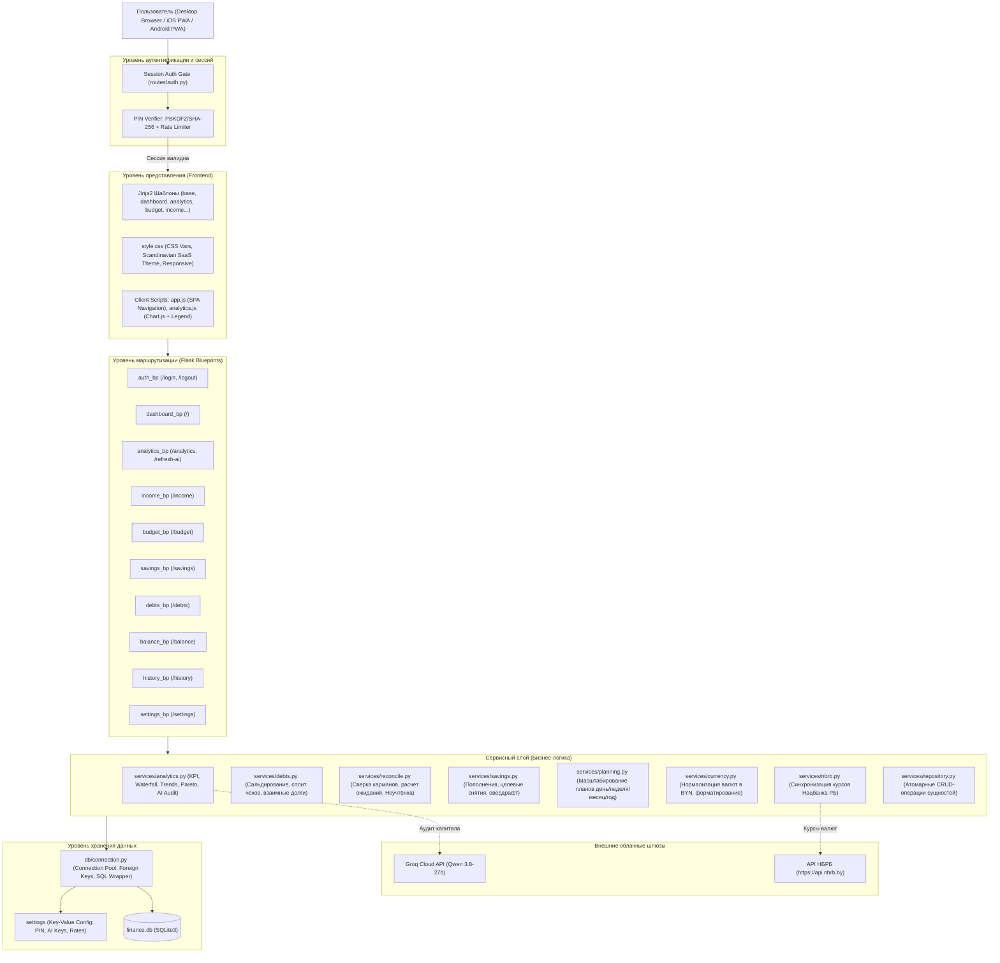
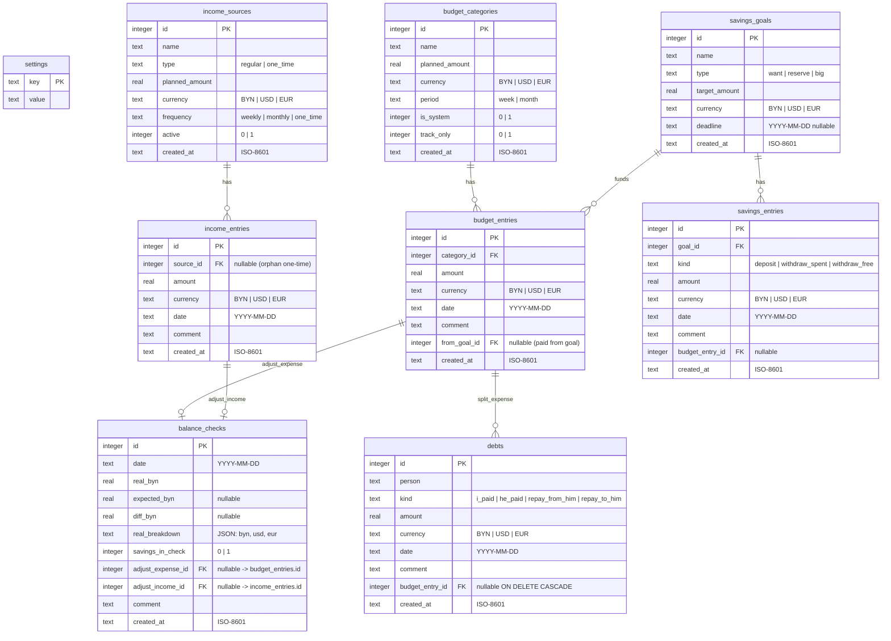

# Полная техническая спецификация системы AkselMoney

---

## 1. Введение и назначение системы

### 1.1. Общие сведения
**AkselMoney** — это автономная персональная финансовая система, ориентированная на жесткий финансовый учет, нулевое бюджетирование (Zero-Based Envelope Budgeting), прозрачный взаимный клиринг долгов, еженедельный аудит остатков карманов и глубокую предиктивную аналитику с искусственным интеллектом.

Система спроектирована по принципу **Offline-First / Single-Tenant Data Sovereignty**: все финансовые транзакции, ключи и история хранятся в локальной СУБД SQLite с возможностью бесшовного переключения на облачный PostgreSQL (Supabase/Render) и защищены сквозной PIN-аутентификацией.

### 1.2. Базовая валюта и финансовая философия
- **Базовая валюта учета**: Белорусский рубль (**BYN**). Все агрегаты, балансы, конверты, аналитика и сверки нормализуются к BYN.
- **Мультивалютный ввод**: Поддержка операций в долларах США (**USD**) и евро (**EUR**) с ежедневным обновлением официальных курсов по API Национального банка Республики Беларусь (**НБРБ**).
- **Пять китов системы**:
  1. **Zero-Based Envelope Budgeting (Конверты)**: операционные расходы делятся на недельные и месячные конверты; расходы сверх лимита немедленно подсвечиваются предупреждающей индикацией.
  2. **Двусторонние накопительные копилки (Two-Way Savings)**: сбережения можно не только копить, но и тратить на целевые покупки (`from_goal_id`) без искусственного слома недельного лимита категории.
  3. **Сальдированный учет долгов (Split Expenses & Debts)**: оплата общего чека картой владельца автоматически изолирует чужую долю от личного бюджета и накапливает нетто-сальдо взаиморасчетов ($B$).
  4. **Контроль реальности карманов (Balance Reconciliation)**: регулярная 3-минутная сверка фактических денег на картах и в кошельке с расчетным балансом системы с автосписанием расхождений в системный конверт «Неучтёнка».
  5. **Аналитический хаб и AI-консультант (Financial Intelligence & AI)**: комплексный аудит капитала за 6 месяцев, 4 KPI здоровья, водопад Cash Flow, ядро трат Парето (80/20), прогноз закрытия целей (ETA) и отчет ИИ на базе модели Qwen 3.8-27b через Groq API.

### 1.3. Терминологический глоссарий
- **Free Cash Flow ($Free$)**: свободный денежный остаток за период за вычетом всех расходов, депозитов в копилки и чистого изменения долгов.
- **Runway (Подушка безопасности)**: срок финансовой автономности в месяцах при среднем уровне расходов за последние 90 дней.
- **Savings Rate (Норма сбережений)**: процент чистого дохода, направляемый в фонд накоплений и капитал.
- **Budget Adherence (Дисциплина бюджета)**: процент конвертов, фактические расходы по которым не превысили установленный плановый лимит.
- **Burn Rate**: средняя скорость расходования денежных средств в сутки.
- **Конверт `track_only`**: системная категория без планового лимита (например, «Неучтёнка»), аккумулирующая технические проводки.
- **Сальдо долга ($B$)**: баланс взаиморасчетов с конкретным лицом ($B > 0$ — мне должны, $B < 0$ — я должен).
- **Целевое снятие (`withdraw_spent`)**: проводка покупки за счет средств копилки с созданием расхода в бюджете без списания из свободного остатка кошелька.

---

## 2. Архитектура системы

### 2.1. Технологический стек

| Компонент | Технология | Версия / Спецификация | Назначение |
|---|---|---|---|
| **Ядро бэкенда** | Python | 3.10+ | Основная логика, математические расчеты, сервисное API |
| **Веб-фреймворк** | Flask | 3.0+ | WSGI приложение, Blueprint-модули, сессии, фильтры шаблонов |
| **СУБД по умолчанию** | SQLite 3 | 3.39+ (`finance.db`) | Транзакционное хранилище, `PRAGMA foreign_keys = ON`, Row-фабрика |
| **Облачная СУБД** | PostgreSQL | 15+ (Supabase / Render) | Опциональное облачное хранилище, полная адаптация SQL-диалекта |
| **WSGI HTTP-сервер** | Gunicorn | 21.2+ | Production веб-сервер с пулом рабочих процессов (workers) |
| **Рендеринг интерфейса** | Jinja2 | 3.1+ | Серверные HTML-шаблоны, макросы форматирования, безопасность XSS |
| **Стили и верстка** | CSS3 Native | Custom Properties, Grid, Flexbox | Скандинавская минималистичная дизайн-система, адаптивность 360px–4K |
| **Визуализация данных** | Chart.js | 4.4.3 (UMD Bundle) | Интерактивные графики трендов, расходов и структуры Парето |
| **Искусственный интеллект** | Groq Cloud API | Qwen 3.8-27b (`groq.com`) | Генерация персонального аудита финансов на естественном языке |
| **Внешние API** | REST API НБРБ | `api.nbrb.by` | Официальные курсы валют (USD, EUR) Нацбанка Республики Беларусь |
| **PWA & Мобильность** | Web App Manifest | W3C Manifest, Apple Touch | Автономный запуск на iOS / Android, полноэкранный режим без URL-бара |

### 2.2. Архитектурная схема взаимодействия



### 2.3. Структура директорий и исходных файлов

```
c:\Users\Legion\Documents\finance\
├── app.py                      # Фабрика приложения create_app(), фильтры Jinja, обработчики ошибок
├── config.py                   # Конфигурация приложения (BaseConfig, LocalConfig, CloudConfig)
├── manage.py                   # CLI утилиты командной строки (update-rates, reset)
├── requirements.txt            # Зависимости Python (Flask, Gunicorn, Requests...)
├── start.bat                   # 1-кликовый запуск для Windows (автоактивация venv и открытие браузера)
├── start.sh                    # Быстрый старт для Linux / macOS
├── .env.example                # Образец переменных окружения
├── db/                         # Слой базы данных
│   ├── __init__.py             # Экспорт интерфейсов get_db, init_db, reset_db
│   ├── connection.py           # Пул коннектов, Row-фабрика, транслятор SQL-плейсхолдеров (%s -> ?)
│   ├── schema.py               # DDL схемы всех 9 таблиц, начальные данные и настройки
│   ├── settings.py             # Интерфейс key-value настроек (get_setting, set_setting)
│   └── migrate.py              # Идемпотентный мигратор базы данных без потери информации
├── routes/                     # Контроллеры Flask Blueprints
│   ├── __init__.py             # Экспорт блюпринтов
│   ├── auth.py                 # Аутентификация по PIN-коду, сессии, brute-force защита
│   ├── dashboard.py            # Главный дашборд, карточка здоровья, быстрые инсайты
│   ├── analytics.py            # Аналитический хаб: KPI здоровья, Водопад, Тренды, Парето, AI
│   ├── income.py               # Источники доходов и поступления
│   ├── budget.py               # Конверты бюджета, списание расходов, сплит совместных чеков
│   ├── savings.py              # Накопительные копилки, взносы, целевые снятия
│   ├── debts.py                # Взаиморасчеты с людьми, журнал долгов, автосальдирование
│   ├── balance.py              # Ревизия и сверка фактического остатка карманов
│   ├── history.py              # Аудит транзакций с фильтрацией и поиском
│   └── settings.py             # Управление курсами валют, смена PIN, настройка AI
├── services/                   # Слой чистой предметной бизнес-логики
│   ├── analytics.py            # Математика аналитики: 4 KPI, Waterfall, 6-Month Trends, Pareto, AI
│   ├── debts.py                # Модель сальдированного долга, нетто-клиринг, сплит чеков
│   ├── reconcile.py            # Математика сверки карманов, ожидаемый остаток, Неучтёнка
│   ├── savings.py              # Проводки копилок, валидация овердрафта, связь с бюджетом
│   ├── planning.py             # Масштабирование планов под периоды (день/неделя/месяц/год)
│   ├── repository.py           # Доменные операции создания/удаления записей
│   ├── currency.py             # Нормализация валют (BYN/USD/EUR), курсы, математика округлений
│   ├── nbrb.py                 # HTTP-клиент к REST API Нацбанка Беларуси
│   ├── dates.py                # Календарная математика, границы периодов, локализация дат
│   ├── forms.py                # Парсинг и строгая валидация входящих форм
│   ├── progress.py             # Логика цветов и статусов прогресс-баров
│   └── constants.py            # Доменные константы валют, периодов, лимитов
├── static/                     # Статические клиентские файлы
│   ├── css/style.css           # Дизайн-система: адаптивные сетки, компоненты, PWA стили
│   ├── js/
│   │   ├── app.js              # Инициализация модалок, SPA-роутинг, Chart.js хелперы, маски
│   │   └── analytics.js        # Инициализация графиков трендов, диаграммы Парето и AI-кнопки
│   ├── img/
│   │   ├── logo.png            # Векторное/растровое лого приложения (512x512)
│   │   ├── apple-touch-icon.png# Иконка для домашнего экрана iOS (180x180)
│   │   ├── favicon-32.png      # Фавиконка для десктопа (32x32)
│   │   └── favicon-16.png      # Фавиконка для вкладок браузера (16x16)
│   ├── manifest.json           # W3C Web App Manifest для PWA-установки
│   └── favicon.ico             # Традиционный ICO-файл
├── templates/                  # Шаблоны страниц Jinja2
│   ├── base.html               # Каркас: монолитный десктопный сайдбар, мобильный бар, модалки
│   ├── macros.html             # UI-макросы: money, currency_select, period_switcher, empty_state
│   ├── login.html              # Экран ввода цифрового PIN-кода с визуальной клавиатурой
│   ├── dashboard.html          # Главная страница: здоровье, графики, конверты, долги
│   ├── analytics.html          # Страница аналитики: KPI, Водопад, Тренды, Парето, Копилки, AI
│   ├── budget.html             # Бюджетные конверты, прогресс-бары, модалка сплита
│   ├── income.html             # Источники прихода, план-факт за месяц
│   ├── savings.html            # Карточки копилок, модалка снятия на цель
│   ├── debts.html              # Взаиморасчеты, баланс долгов, быстрый возврат
│   ├── balance.html            # Форма мультивалютного пересчета карманов и история сверок
│   ├── history.html            # Журнал всех проводок с фильтрами
│   └── settings.html           # Экран настроек: курсы НБРБ, PIN, AI-ключи, копилки в сверке
├── scripts/                    # Автоматизированное тестирование и утилиты
│   └── verify_db.py            # Комплексный тест бизнес-правил (A–K) и HTTP Smoke
└── docs/                       # Документация проекта
    └── SPECIFICATION.md        # Настоящий документ полной технической спецификации
```

---

## 3. Модель данных (Data Model Specification)

### 3.1. Entity-Relationship диаграмма (Mermaid)



### 3.2. Спецификация таблиц базы данных

#### 1. Таблица `settings`
Хранилище глобальных параметров приложения в формате ключ-значение:
- `key` (`TEXT PRIMARY KEY`): Идентификатор параметра.
- `value` (`TEXT NOT NULL`): Сериализованное строковое значение.

*Реестр системных ключей:*
- `pin_code`: Локальный хеш/значение PIN (устаревший fallback; основной секрет `APP_PASSWORD` загружается из изолированного `.env`).
- `usd_rate`: Текущий курс доллара США к белорусскому рублю (по умолчанию `'3.27'`).
- `eur_rate`: Текущий курс евро к белорусскому рублю (по умолчанию `'3.55'`).
- `rates_updated_at`: Временная метка последней синхронизации курсов (ISO-8601).
- `rates_nbrb_date`: Дата курсов по календарю Нацбанка РБ (`YYYY-MM-DD`).
- `savings_in_check`: Флаг учета копилок при сверке (`'1'` — копилки входят в посчитанные деньги; `'0'` — лежат изолированно).
- `default_debt_person`: Контрагент по умолчанию для быстрых совместных трат (по умолчанию `'Кент'`).
- `ai_api_key`: API-ключ сервиса Groq Cloud (рекомендуется передавать через переменную окружения `GROQ_API_KEY` в файле `.env`, чтобы ключ не попадал в открытые дампы базы данных).
- `ai_model`: Имя языковой модели (по умолчанию `'qwen/qwen3.8-27b'`).
- `ai_provider`: Провайдер LLM (по умолчанию `'groq'`).

#### 2. Таблица `income_sources`
Источники регулярных и разовых доходов:
- `id` (`INTEGER PRIMARY KEY AUTOINCREMENT`).
- `name` (`TEXT NOT NULL`): Название («Зарплата», «Клиент А», «Папаня»).
- `type` (`TEXT NOT NULL`): `regular` (регулярный поток) или `one_time` (разовый контракт).
- `planned_amount` (`REAL NOT NULL`): Плановая сумма в валюте источника.
- `currency` (`TEXT NOT NULL DEFAULT 'BYN'`): Валюта плана (`BYN`, `USD`, `EUR`).
- `frequency` (`TEXT NOT NULL DEFAULT 'monthly'`): Периодичность (`weekly`, `monthly`, `one_time`).
- `active` (`INTEGER NOT NULL DEFAULT 1`): Статус активности (1 — активен, 0 — в архиве).
- `created_at` (`TEXT NOT NULL`): Время создания ISO-8601.

#### 3. Таблица `income_entries`
Фактические транзакции поступления средств:
- `id` (`INTEGER PRIMARY KEY AUTOINCREMENT`).
- `source_id` (`INTEGER REFERENCES income_sources(id) ON DELETE SET NULL`): Ссылка на источник дохода. Может быть `NULL` для разовых внеплановых поступлений и излишков сверок.
- `amount` (`REAL NOT NULL`): Сумма поступления (> 0).
- `currency` (`TEXT NOT NULL DEFAULT 'BYN'`): Валюта поступления.
- `date` (`TEXT NOT NULL`): Дата получения `YYYY-MM-DD`.
- `comment` (`TEXT`): Пользовательское примечание.
- `created_at` (`TEXT NOT NULL`): Метка создания ISO-8601.

#### 4. Таблица `budget_categories`
Конверты расходов:
- `id` (`INTEGER PRIMARY KEY AUTOINCREMENT`).
- `name` (`TEXT NOT NULL`): Название конверта («Продукты», «Аренда жилья», «Неучтёнка»).
- `planned_amount` (`REAL NOT NULL DEFAULT 0`): Плановый лимит на базовый период.
- `currency` (`TEXT NOT NULL DEFAULT 'BYN'`): Валюта лимита.
- `period` (`TEXT NOT NULL DEFAULT 'month'`): Базовый цикл конверта (`week` или `month`).
- `is_system` (`INTEGER NOT NULL DEFAULT 0`): Системный конверт (1 — защищен от удаления и переименования).
- `track_only` (`INTEGER NOT NULL DEFAULT 0`): Режим учета без лимита (1 — не рассчитывает процент перерасхода, для технических проводок).
- `created_at` (`TEXT NOT NULL`): Метка создания ISO-8601.

*Примечание*: Системный конверт `Неучтёнка` инициализируется со свойствами: `is_system=1`, `track_only=1`, `planned_amount=0`, `period='month'`.

#### 5. Таблица `budget_entries`
Фактические списания расходов:
- `id` (`INTEGER PRIMARY KEY AUTOINCREMENT`).
- `category_id` (`INTEGER NOT NULL REFERENCES budget_categories(id) ON DELETE CASCADE`): Конверт расхода.
- `amount` (`REAL NOT NULL`): Сумма списания (> 0).
- `currency` (`TEXT NOT NULL DEFAULT 'BYN'`): Валюта транзакции.
- `date` (`TEXT NOT NULL`): Дата расхода `YYYY-MM-DD`.
- `comment` (`TEXT`): Детализация чека / магазина.
- `from_goal_id` (`INTEGER REFERENCES savings_goals(id) ON DELETE SET NULL`): Ссылка на копилку, если трата оплачена из накоплений.
- `created_at` (`TEXT NOT NULL`): Метка создания ISO-8601.

#### 6. Таблица `savings_goals`
Цели накопления (копилки):
- `id` (`INTEGER PRIMARY KEY AUTOINCREMENT`).
- `name` (`TEXT NOT NULL`): Имя цели («Подушка безопасности», «Новый Макбук», «Отпуск»).
- `type` (`TEXT NOT NULL DEFAULT 'want'`): Тип (`reserve` — подушка, `big` — крупная цель, `want` — хотелка).
- `target_amount` (`REAL NOT NULL`): Целевая сумма накопления в валюте цели.
- `currency` (`TEXT NOT NULL DEFAULT 'BYN'`): Валюта цели (`BYN`, `USD`, `EUR`).
- `deadline` (`TEXT`): Желаемый дедлайн достижения `YYYY-MM-DD`.
- `created_at` (`TEXT NOT NULL`): Метка создания ISO-8601.

#### 7. Таблица `savings_entries`
Транзакции движения средств по копилкам:
- `id` (`INTEGER PRIMARY KEY AUTOINCREMENT`).
- `goal_id` (`INTEGER NOT NULL REFERENCES savings_goals(id) ON DELETE CASCADE`): Копилка.
- `kind` (`TEXT NOT NULL DEFAULT 'deposit'`):
  - `deposit`: внесение средств в копилку;
  - `withdraw_spent`: снятие средств на покупку (связано с записью в `budget_entries`);
  - `withdraw_free`: снятие средств с возвратом в операционный свободный остаток кошелька.
- `amount` (`REAL NOT NULL`): Сумма операции (> 0).
- `currency` (`TEXT NOT NULL DEFAULT 'BYN'`): Валюта операции.
- `date` (`TEXT NOT NULL`): Дата операции `YYYY-MM-DD`.
- `comment` (`TEXT`): Примечание.
- `budget_entry_id` (`INTEGER REFERENCES budget_entries(id) ON DELETE SET NULL`): Взаимная ссылка на расход для проводок `withdraw_spent`.
- `created_at` (`TEXT NOT NULL`): Метка создания ISO-8601.

#### 8. Таблица `debts`
Журнал учета долгов и совместных чеков:
- `id` (`INTEGER PRIMARY KEY AUTOINCREMENT`).
- `person` (`TEXT NOT NULL`): Имя контрагента.
- `kind` (`TEXT NOT NULL`):
  - `i_paid`: я заплатил за человека (сальдо $B$ растет);
  - `he_paid`: человек заплатил за меня (сальдо $B$ падает);
  - `repay_from_him`: человек вернул мне долг (сальдо $B$ закрывается, кошелек пополняется);
  - `repay_to_him`: я вернул долг человеку (сальдо $B$ закрывается, кошелек уменьшается).
- `amount` (`REAL NOT NULL`): Сумма операции (> 0).
- `currency` (`TEXT NOT NULL DEFAULT 'BYN'`): Валюта долга.
- `date` (`TEXT NOT NULL`): Дата операции `YYYY-MM-DD`.
- `comment` (`TEXT`): Комментарий к долгу.
- `budget_entry_id` (`INTEGER REFERENCES budget_entries(id) ON DELETE CASCADE`): Ссылка на расход бюджета при сплите общего чека.
- `created_at` (`TEXT NOT NULL`): Метка создания ISO-8601.

*Индексы:*
- `idx_debts_person_date` по `(person, date)`
- `idx_debts_budget_entry` по `(budget_entry_id)`

#### 9. Таблица `balance_checks`
Акты еженедельной ревизии карманов:
- `id` (`INTEGER PRIMARY KEY AUTOINCREMENT`).
- `date` (`TEXT NOT NULL`): Дата проведения сверки `YYYY-MM-DD`.
- `real_byn` (`REAL NOT NULL`): Фактическая сумма денег на руках в BYN.
- `expected_byn` (`REAL`): Расчетная ожидаемая сумма по проводкам (для базовой сверки `NULL`).
- `diff_byn` (`REAL`): Расхождение $\text{diff} = \text{real} - \text{expected}$ (для базовой `NULL`).
- `real_breakdown` (`TEXT`): JSON-снапшот мультивалютного ввода: `{"byn": 1000.0, "usd": 50.0, "eur": 0.0}`.
- `savings_in_check` (`INTEGER NOT NULL DEFAULT 1`): Состояние настройки на момент сверки.
- `adjust_expense_id` (`INTEGER REFERENCES budget_entries(id) ON DELETE SET NULL`): Расход в «Неучтёнку» при недостаче ($\text{diff} < 0$).
- `adjust_income_id` (`INTEGER REFERENCES income_entries(id) ON DELETE SET NULL`): Доход в «Неучтённый приход» при излишке ($\text{diff} > 0$).
- `comment` (`TEXT`): Примечание.
- `created_at` (`TEXT NOT NULL`): Метка создания ISO-8601.

---

## 4. Математические и финансовые формулы системы

### 4.1. Мультивалютная конвертация
Все операции конвертируются в базовую валюту учета (BYN) по актуальным курсам:
$$\text{to\_byn}(A, C) = \begin{cases}
A, & \text{если } C = \text{BYN} \\
A \times \text{usd\_rate}, & \text{если } C = \text{USD} \\
A \times \text{eur\_rate}, & \text{если } C = \text{EUR}
\end{cases}$$

$$\text{from\_byn}(A_{byn}, C_{target}) = \begin{cases}
A_{byn}, & \text{если } C_{target} = \text{BYN} \\
\frac{A_{byn}}{\text{usd\_rate}}, & \text{если } C_{target} = \text{USD} \\
\frac{A_{byn}}{\text{eur\_rate}}, & \text{если } C_{target} = \text{EUR}
\end{cases}$$

Все расчеты выполняются с машинной точностью $\varepsilon = 0.005$, результаты форматируются с округлением до 2 десятичных знаков.

---

### 4.2. Свободный денежный остаток (Free Cash Flow)
Свободный остаток операционного кошелька за период $[T_{start}, T_{end}]$ рассчитывается по строгой формуле денежного потока:

$$\text{Free} = \text{Inc} - \text{Exp}_{own} - \text{Dep} + \text{W}_{free} - \Delta B$$

где:
- $\text{Inc} = \sum \text{to\_byn}(amount)$ по всем `income_entries` за период.
- $\text{Exp}_{own} = \sum \text{to\_byn}(amount)$ по всем `budget_entries` за период, где `from_goal_id IS NULL` (траты из копилок исключены, так как средства уже были учтены при внесении в копилку).
- $\text{Dep} = \sum \text{to\_byn}(amount)$ по `savings_entries` с `kind = 'deposit'`.
- $\text{W}_{free} = \sum \text{to\_byn}(amount)$ по `savings_entries` с `kind = 'withdraw_free'`.
- $\Delta B$ — чистое изменение долгового сальдо за период:
  $$\Delta B = \sum \text{i\_paid} - \sum \text{he\_paid} - \sum \text{repay\_from\_him} + \sum \text{repay\_to\_him}$$
  В формуле $\text{Free}$ величина $\Delta B$ вычитается: когда пользователь платит за друга (`i_paid`), $\Delta B > 0$ и свободный остаток уменьшается; когда друг возвращает долг (`repay_from_him`), $\Delta B < 0$ и свободный остаток увеличивается.

---

### 4.3. Баланс накопительной копилки
Текущий баланс копилки $G_k$ вычисляется в валюте самой копилки:
$$\text{Balance}(G_k) = \sum \text{from\_byn}(\text{to\_byn}(\text{amount}, C), C_{goal})$$
по всем записям копилки, где:
- `kind = 'deposit'` входит со знаком $+$;
- `kind = 'withdraw_spent'` входит со знаком $-$;
- `kind = 'withdraw_free'` входит со знаком $-$.

Запрет овердрафта: $\text{Balance}(G_k) \ge 0$. Попытка списания суммы больше текущего баланса блокируется на уровне сервисного слоя.

---

### 4.4. Сальдо взаиморасчетов по долгам
Баланс долга с конкретным контрагентом $P$:
$$B(P) = \sum_{P} (\text{i\_paid} + \text{repay\_to\_him}) - \sum_{P} (\text{he\_paid} + \text{repay\_from\_him})$$
- $B(P) > 0$: Контрагент должен пользователю.
- $B(P) < 0$: Пользователь должен контрагенту.
- $B(P) = 0$: Взаимный расчет закрыт («В расчёте»).

---

### 4.5. Математика сверки остатков карманов (Reconciliation Engine)
1. **Базовая сверка**: фиксирует точку отсчета $\text{Real}_0$ на дату $T_0$.
2. **Регулярная сверка на дату $T_1$**: расчет ожидаемого остатка по операциям в интервале $T_0 < date \le T_1$:
   $$\text{Expected}_1 = \text{Real}_0 + \text{Inc} - \text{Exp}_{own} - \Delta B - \text{Flows}_{savings}$$
   где $\text{Flows}_{savings}$ зависит от настройки `savings_in_check`:
   $$\text{Flows}_{savings} = \begin{cases}
   \sum \text{to\_byn}(\text{budget\_entries.amount})_{\text{from\_goal}}, & \text{если } \text{savings\_in\_check} = 1 \\
   \text{Dep} - \text{W}_{free}, & \text{если } \text{savings\_in_check} = 0
   \end{cases}$$
3. **Расхождение остатка**:
   $$\text{Diff} = \text{Real}_1 - \text{Expected}_1$$
   - $\text{Diff} = 0$: Идеальное совпадение.
   - $\text{Diff} < 0$: Недостача. Создается расход в системной категории «Неучтёнка» на сумму $|\text{Diff}|$.
   - $\text{Diff} > 0$: Излишек. Создается разовый доход «Неучтённый приход» на сумму $\text{Diff}$.

---

### 4.6. Аналитические формулы здоровья капитала (`/analytics`)

#### 1. Норма сбережений (Savings Rate, $SR$)
$$SR = \frac{\max(0, \text{Dep} - \text{W}_{free})}{\max(0.01, \text{Inc})} \times 100\%$$
- $SR \ge 20\%$: Статус `Отлично` (`ok`, зеленый).
- $10\% \le SR < 20\%$: Статус `Норма` (`warning`, желтый).
- $SR < 10\%$: Статус `Низкая` (`danger`, красный).

#### 2. Подушка безопасности (Financial Runway, $R$)
Оценивает автономный запас жизни в месяцах при среднем расходе за последние 90 дней:
$$\text{AvgExp}_{90} = \frac{\sum_{date \in [Today-90, Today]} \text{Exp}_{own}}{3.0}$$
$$R = \frac{\text{TotalSavings}}{\max(1.0, \text{AvgExp}_{90})}$$
где $\text{TotalSavings} = \sum_{k} \text{to\_byn}(\text{Balance}(G_k))$.
- $R \ge 6.0$ мес: Статус `Капитал` (`stellar`, зеленый).
- $3.0 \le R < 6.0$ мес: Статус `Надёжно` (`ok`, зеленый).
- $1.0 \le R < 3.0$ мес: Статус `Минимум` (`warning`, желтый).
- $R < 1.0$ мес: Статус `Критично` (`danger`, красный).

#### 3. Дисциплина бюджета (Budget Adherence, $Adh$)
Доля конвертов расходов, не превысивших лимит в текущем месяце:
$$Adh = \frac{N_{in\_limit}}{N_{total}} \times 100\%$$
где конверт считается удержанным, если $\text{Spent}_{own} \le \text{Planned}_{scaled}$ или $\text{Planned} = 0$.
- $Adh \ge 80\%$: Статус `ok` (зеленый).
- $Adh < 80\%$: Статус `warning` (желтый).

#### 4. Дневной расход (Burn Rate)
$$\text{Burn} = \frac{\text{Exp}_{own, month}}{\text{Количество дней месяца с 1-го числа}}$$

#### 5. Структура Парето (Закон 80/20)
Все категории расходов месяца ранжируются по убыванию суммы трат:
$$S_1 \ge S_2 \ge \dots \ge S_n$$
Вычисляются накопленные суммы $\text{Cum}(k) = \sum_{i=1}^k S_i$ и кумулятивная доля $\frac{\text{Cum}(k)}{\sum S_i}$.
Категории, входящие в кумулятивные 80%, помечаются как **Ядро расходов (Core)**.

#### 6. Прогноз сроков закрытия целей (ETA Forecast)
Для каждой активной цели накопления с целевой суммой $\text{Target}$ и текущим балансом $\text{Current}$:
1. Рассчитывается среднемесячный темп взносов за последние 90 дней:
   $$\text{Pace} = \frac{\sum_{date \in [Today-90, Today]} \text{deposit} - \sum \text{withdraw}}{3.0}$$
2. Если $\text{Pace} > 0$ и $\text{Current} < \text{Target}$:
   $$\text{MonthsLeft} = \frac{\text{Target} - \text{Current}}{\text{Pace}}$$
   $$\text{ETA} = \text{Today} + \text{MonthsLeft} \times 30.44 \text{ дней}$$
3. Если у цели задан дедлайн:
   - При $\text{ETA} \le \text{Deadline}$: статус `В графике` (`badge-ok`).
   - При $\text{ETA} > \text{Deadline}$: статус `Отстаёт` (`badge-danger`).

---

## 5. Спецификация модулей приложения

### 5.1. Модуль аутентификации (`routes/auth.py`)
- Защита всех эндпоинтов декоратором `@login_required`.
- PIN-код хранится в таблице `settings` (`pin_code`).
- При запросе неавторизованного пользователя выполняется `302 Redirect` на `/login?next=...`.
- Модель защиты от брутфорса:
  - 5 неудачных попыток ввода PIN блокируют IP-адрес на 60 секунд.
  - Постоянная сессионная cookie с флагами `HttpOnly`, `SameSite=Lax`, `permanent = True` на 365 дней.

### 5.2. Модуль «Дашборд» (`routes/dashboard.py`)
- **Полоса финансового здоровья (`.health-card`)**:
  - Карточка с 3-колоночным строгим вертикальным ритмом (`Сбережения`, `Подушка`, `Конверты`).
  - Тонкие вертикальные разделители между метриками.
  - Элегантная текстовая ссылка в шапке карточки `Подробный аудит →`.
- **Переключатель периодов**: `День`, `Неделя`, `Месяц`, `Год`.
- **Карточки KPI**: Свободный остаток, Приход, Расходы, Всего накоплено, Долги, Сверка.
- **Интерактивные графики**: Расходы по категориям (Chart.js) и План-факт приходов.
- **Конверты и Ожидаемые поступления**: компактные списки с нативными ссылками `.section-link` (`В бюджет →`, `В приходы →`) с запретом на перенос текста (`white-space: nowrap !important; flex-shrink: 0 !important;`).

### 5.3. Аналитический хаб и ИИ-Ассистент (`routes/analytics.py`)
- **4 KPI здоровья капитала**: Сбережения, Подушка, Конверты, Дневной расход.
- **Водопад Cash Flow (`.waterfall-scroll-container`)**:
  - Горизонтальный плавный свайп-контейнер (`scroll-snap`) для мобильных устройств.
  - Аккуратный плавающий чип «Остаток: X BYN» в шапке секции без вертикального сжатия.
- **Динамика 6 месяцев (`#trendsChart`)**:
  - Мульти-линейный график Chart.js: Доходы (зеленый), Расходы (коралловый), Сбережения (синий).
  - Сводный ленточный блок показателей: средний доход, средний расход, средние сбережения, итоговый свободный остаток за полгода.
- **Структура трат (Парето)**:
  - Кольцевая диаграмма Donut (`#paretoChart`) со специальной 12-цветной высококонтрастной палитрой (синий `#2563eb`, изумрудный `#10b981`, янтарный `#f59e0b`, фиолетовый `#8b5cf6`, коралловый `#ef4444`, бирюзовый `#06b6d4`, розовый `#ec4899`, оранжевый `#f97316`, индиго `#6366f1`, тиловый `#14b8a6`, лаймовый `#84cc16`, сланцевый `#64748b`).
  - Структурированный HTML-список категорий справа от диаграммы (цветной маркер, имя, процент доли, сумма в BYN).
- **Сдвиги расходов**: карточка топ-категорий роста и экономии по сравнению с предшествующим месяцем.
- **Прогноз достижения целей**: карточки копилок с индикацией темпа пополнения в месяц и расчетной датой закрытия цели (ETA).
- **ИИ-Консультант (Groq LLM Qwen 3.8-27b)**:
  - Автоматическая передача структурированного JSON-снапшота финансов в LLM.
  - Генерация отчета по 4 пунктам: кэшфлоу, точки риска, подушка, практические шаги.
  - Автономный эвристический фолбэк-движок: при сбоях связи или блокировке Cloudflare моментально генерирует детерминированный аудит на чистом русском языке.
  - Кнопка «Обновить аудит» (`POST /analytics/refresh-ai`) с асинхронным обновлением DOM без перезагрузки страницы.

### 5.4. Модуль «Бюджет» (`routes/budget.py`)
- Переключение недельного и месячного циклов конвертов.
- Модальное окно списания расхода:
  - Поддержка калькулятора и множителей в комментариях.
  - Чекбокс «Разделить чек»: выбор «Я оплатил» / «Он оплатил», автоматический расчет долей, создание расхода строго на долю пользователя и создание долговой записи в `debts`.

### 5.5. Модуль «Накопления» (`routes/savings.py`)
- Карточки копилок (`reserve`, `big`, `want`).
- Модальное окно пополнения копилки (`deposit`).
- Модальное окно снятия накоплений:
  - Вариант «Потратил»: автосоздание расхода в бюджете с `from_goal_id`, списание с баланса цели, отсутствие влияния на недельный лимит конверта.
  - Вариант «Вернуть в свободные»: возврат средств в операционный кошелек.
  - Жесткий запрет овердрафта.

### 5.6. Модуль «Долги» (`routes/debts.py`)
- Сводный баланс взаиморасчетов по каждому контрагенту.
- Кнопка быстрого закрытия долга («Он вернул долг» / «Я вернул долг») в 1 тап.
- Ручной ввод долговых операций.
- Хронологическая таблица долгов.

### 5.7. Модуль «Сверка» (`routes/balance.py`)
- Форма мультивалютного ввода карманов (BYN, USD, EUR).
- Мгновенный пересчет общего эквивалента в BYN на клиенте.
- Расчет ожидаемого баланса по формуле потоков.
- Определение расхождения $\text{Diff}$ и автоматическая проводка корректировок (расход в «Неучтёнку» или доход в «Неучтённый приход»).

### 5.8. Модуль «История» (`routes/history.py`)
- Единый сквозной журнал всех типов транзакций.
- Фильтры по диапазону дат, категории, типу операции.
- Сводные итоги в подвале журнала.

### 5.9. Модуль «Настройки» (`routes/settings.py`)
- Принудительная синхронизация курсов НБРБ через API.
- Настройка PIN-кода доступа.
- Конфигурация API-ключа Groq и модели.
- Переключатель опции `savings_in_check`.

---

## 6. Спецификация пользовательского интерфейса (Design System & PWA)

### 6.1. Цветовая палитра и дизайн-токены (Scandinavian Minimalist SaaS)
Дизайн системы вдохновлен эстетикой скандинавских финтех-сервисов (Linear, Stripe, Raycast, Monarch Money):

```css
:root {
  --bg-app: #f7f4ee;              /* Теплый фоновый цвет бумажного полотна */
  --surface: #ffffff;             /* Чистая карточка */
  --surface-raised: #fbf9f5;      /* Приподнятый блок / ховер */
  --hairline: #eae5dc;            /* Тонкая рамка разделения */
  --hairline-strong: #ded8cb;     /* Акцентная рамка */
  --text-primary: #1f1b16;        /* Основной контрастный текст */
  --text-secondary: #5c5549;      /* Вторичный приглушенный текст */
  --text-muted: #8c8273;          /* Подписи и единицы измерения */
  --accent: #1b5e3f;              /* Фирменный хвойно-изумрудный акцент */
  --accent-hover: #144931;        /* Темный хвойный ховер */
  --accent-light: #e8f3ed;        /* Мягкая изумрудная заливка бейджей */
  --danger: #c93b3b;              /* Кораллово-красный дефицит / ошибка */
  --danger-light: #fae8e8;        /* Мягкая красная заливка */
  --warning: #b87414;             /* Янтарно-золотой статус внимания */
  --warning-light: #fdf3e7;       /* Мягкая янтарная заливка */
}
```

### 6.2. Типографика
- **Основной интерфейсный шрифт**: `Inter` (`-apple-system, BlinkMacSystemFont, "Segoe UI", Roboto, sans-serif`).
- **Моноширинный финансовый шрифт**: `JetBrains Mono` (`monospace`). Все денежные суммы, проценты, даты и числовые показатели строго рендерятся в моноширинном начертании (`font-variant-numeric: tabular-nums`) для идеального выравнивания разрядов.

### 6.3. Адаптивная сетка и брейкпоинты
- **Desktop (> 840px)**:
  - Фиксированный вертикальный монолитный сайдбар слева шириной `220px`.
  - Основной контент шириной до `1180px` с плавным центрированием.
  - Нижняя навигация и мобильная шапка скрыты (`display: none`).
- **Tablet & Mobile (<= 840px)**:
  - Сайдбар полностью скрыт (`display: none !important`).
  - Верхняя плавающая шапка с логотипом и курсами валют (`.mobile-topbar`, `height: 58px`, `backdrop-filter: blur(14px)`).
  - Фиксированная нижняя навигация (`.bottom-nav`, `height: 66px + safe-area-inset-bottom`).
  - 4 ключевых раздела (`Дашборд`, `Бюджет`, `Приходы`, `Копилки`) + кнопка модального меню «Ещё» (для доступа к `Аналитике`, `Долгам`, `Сверке`, `Истории` и `Настройкам`).
- **Small Mobile (<= 380px)**:
  - Автоматическое сворачивание двухколоночных сеток в одну колонку.
  - Компактный размер шрифтов и минимальные внутренние отступы карточек.

### 6.4. Жесткие правила верстки компонентов
1. **Запрет разрыва слов в бейджах и кнопках**:
   Все классы `.badge`, `.kpi-badge`, `.btn`, `.btn-sm`, `.section-link` строго снабжены `white-space: nowrap !important; flex-shrink: 0 !important;`. Ни при каких условиях стрелки `→` или текст статусов не переносятся на вторую строчку.
2. **Адаптивные заголовки секций (`.section-head`)**:
   На мобильных устройствах заголовки карточек с кнопками или чипами автоматически выстраиваются в вертикальный стек (`flex-direction: column; align-items: flex-start; gap: 10px;`), гарантируя 100% ширины заголовку и естественный размер кнопке действия.
3. **Монолитность навигации**:
   Полностью устранены браузерные конфликты View Transitions: сайдбар на десктопе никогда не перекрывается снимком контента и не прыгает при переходах.

---

## 7. Сценарии использования (Use Cases)

| Код | Название сценария | Описание и результат |
|---|---|---|
| **UC-01** | Авторизация по PIN-коду | Пользователь вводит 4 цифры, система проверяет хэш и открывает сессию на 365 дней. |
| **UC-02** | Просмотр сводки дашборда | Пользователь переключает период (Месяц) и видит свободный остаток, приход, расход и карточку здоровья. |
| **UC-03** | Списание расхода из конверта | Ввод суммы `25.50 BYN`, категории «Продукты», комментарий `Евроопт`. Конверт списывает лимит, $Free$ падает на 25.50. |
| **UC-04** | Разделение чека при оплате за двоих | Чек 80 BYN в кафе: моя доля 40, доля друга 40. Конверт тратит 40, долг друга растет на 40, из кошелька уходит 80. |
| **UC-05** | Возврат долга другом | Друг перевел 40 BYN. Нажатие «Он вернул долг» в 1 тап. Долг закрыт ($B=0$), $Free$ увеличился на 40 BYN. |
| **UC-06** | Пополнение накопительной копилки | Внесение 300 BYN в цель «Подушка безопасности». Баланс копилки растет, $Free$ уменьшается на 300 BYN. |
| **UC-07** | Целевая покупка из накоплений | Снятие 200 BYN из копилки «Ноутбук» с выбором «Потратил» в категорию «Техника». Баланс копилки падает, расход создан с `from_goal_id`, лимит конверта не пострадал, $Free$ не изменился. |
| **UC-08** | Возврат накоплений в кошелек | Снятие 100 BYN с выбором «Вернуть в свободные». Баланс цели падает на 100, $Free$ увеличивается на 100 BYN. |
| **UC-09** | Еженедельная сверка карманов | Ввод наличности и остатка карт (BYN, USD, EUR). При недостаче 15 BYN система списывает 15 BYN в «Неучтёнку». |
| **UC-10** | Анализ здоровья и 6-месячных трендов | Открытие `/analytics`: просмотр нормы сбережений, запаса подушки в месяцах, цепочки Waterfall и динамики за полгода. |
| **UC-11** | Анализ ядра расходов Парето | Просмотр 12-цветной круговой диаграммы: определение категорий, формирующих 80% трат, и проверка сдвигов к прошлому месяцу. |
| **UC-12** | Прогноз дедлайнов целей (ETA) | Анализ карточек копилок: просмотр темпа пополнения в BYN/мес и расчетного месяца закрытия цели. |
| **UC-13** | Запуск ИИ-аудита | Нажатие кнопки «Обновить аудит»: получение структурированного отчета Groq LLM (Qwen 3.8-27b) с форматированием. |
| **UC-14** | Синхронизация курсов НБРБ | Нажатие иконки обновления в виджете валют: подгрузка свежих курсов USD/EUR через REST API Нацбанка РБ. |
| **UC-15** | Добавление нового источника дохода | Создание регулярного источника «Клиентский контракт» с планом 1500 USD/мес. |
| **UC-16** | Установка PWA на смартфон | Открытие сайта в Safari на iOS, выбор «На экран Домой»: появление полноценного приложения с кастомной иконкой. |

---

## 8. Эксплуатация и развертывание на сервере (Production Runbook)

### 8.1. Системные требования
- **ОС**: Debian 12 / 13 (Trixie) или Ubuntu 22.04 / 24.04 LTS
- **Архитектура**: x86_64 или aarch64
- **Ресурсы**: 1 vCPU, 1 GB RAM, 10 GB SSD
- **Порты**: TCP 80 (HTTP), TCP 443 (HTTPS), TCP 22 (SSH)

### 8.2. Сервисный юнит Systemd (`/etc/systemd/system/finance.service`)
```ini
[Unit]
Description=AkselMoney Production Application
After=network.target

[Service]
Type=simple
User=finance
Group=finance
WorkingDirectory=/opt/finance
EnvironmentFile=/opt/finance/.env
Environment="PATH=/opt/finance/venv/bin:/usr/local/bin:/usr/bin"
ExecStart=/opt/finance/venv/bin/gunicorn \
    --workers 3 \
    --bind 127.0.0.1:5000 \
    --timeout 60 \
    --access-logfile /var/log/finance-access.log \
    --error-logfile /var/log/finance-error.log \
    app:app
Restart=always
RestartSec=3

[Install]
WantedBy=multi-user.target
```

### 8.3. Конфигурация Nginx Reverse Proxy (`/etc/nginx/sites-available/finance`)
```nginx
# Редирект HTTP на HTTPS
server {
    listen 80;
    server_name your-domain.com <your_server_ip>;
    return 301 https://$host$request_uri;
}

# Защищенный HTTPS сервер
server {
    listen 443 ssl http2;
    server_name your-domain.com <your_server_ip>;

    ssl_certificate /etc/ssl/certs/finance.crt;
    ssl_certificate_key /etc/ssl/private/finance.key;
    ssl_protocols TLSv1.2 TLSv1.3;
    ssl_ciphers HIGH:!aNULL:!MD5;

    client_max_body_size 20M;

    # Статические файлы отдаются Nginx напрямую минуя Python
    location /static/ {
        alias /opt/finance/static/;
        expires 30d;
        add_header Cache-Control "public, max-age=2592000, immutable";
        access_log off;
    }

    location / {
        proxy_pass http://127.0.0.1:5000;
        proxy_set_header Host $host;
        proxy_set_header X-Real-IP $remote_addr;
        proxy_set_header X-Forwarded-For $proxy_add_x_forwarded_for;
        proxy_set_header X-Forwarded-Proto $scheme;
        proxy_read_timeout 60s;
        proxy_connect_timeout 15s;
    }
}
```

### 8.4. Регламент резервного копирования базы данных
Резервная копия SQLite создается средствами утилиты `sqlite3` в режиме онлайн без остановки веб-сервера:
```bash
#!/bin/bash
# Скрипт ежедневного бэкапа: /opt/finance/scripts/backup.sh
BACKUP_DIR="/opt/finance/backups"
TIMESTAMP=$(date +"%Y%m%d_%H%M%S")
mkdir -p "$BACKUP_DIR"

sqlite3 /opt/finance/finance.db ".backup '$BACKUP_DIR/finance_$TIMESTAMP.db'"
gzip "$BACKUP_DIR/finance_$TIMESTAMP.db"

# Удаление копий старше 30 дней
find "$BACKUP_DIR" -type f -name "*.db.gz" -mtime +30 -delete
```

### 8.5. Регламент доставки обновлений (Zero-Data-Loss Deploy)
Файлы базы данных (`finance.db*`) находятся в `.gitignore` и никогда не затираются при обновлении:
```bash
# 1. На локальной машине: сборка дистрибутива
tar -czf update.tar.gz \
    --exclude='finance.db*' \
    --exclude='__pycache__' \
    --exclude='*.pyc' \
    app.py config.py routes/ services/ static/ templates/

# 2. Передача архива на сервер
scp update.tar.gz root@<your_server_ip>:/tmp/update.tar.gz

# 3. Применение на сервере и бесшовный рестарт
ssh root@<your_server_ip> "tar -xzf /tmp/update.tar.gz -C /opt/finance && chown -R finance:finance /opt/finance && rm /tmp/update.tar.gz && systemctl restart finance && systemctl is-active finance"
```

---

## 9. Заключение
Настоящая спецификация является исчерпывающим эталонным документом архитектуры, логики, математических формул и эксплуатационных процедур проекта **AkselMoney**. Любые последующие доработки системы должны строго соответствовать описанным контрактам данных и бизнес-правилам.
